# Kuznitsa — Self-Hosted 3D-Printer Farm Dashboard

📖 **Documentation (English / Русский): https://mihey-web.github.io/printer-fleet-dashboard/**

A lightweight, self-hosted dashboard for monitoring and controlling a mixed fleet
of 3D printers from one web page. Built for print farms that run more than one
brand of machine and want a single, always-on status board with history,
notifications, and basic remote control.

Supports **Bambu Lab**, **Creality** (K1 / K2 series, Ender-5 Max, Sonic Pad),
**Klipper / Moonraker**, and **MKS WiFi** printers side by side.

*All screenshots use a synthetic demo farm — no real printers or jobs.*

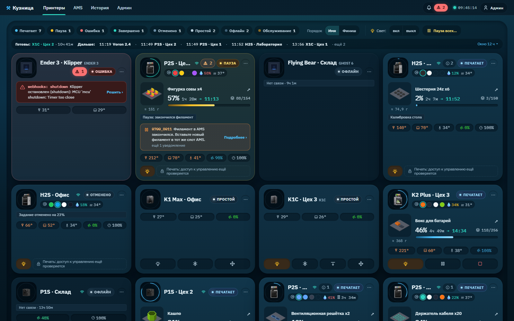

*Printers — every printer on one page: state, progress, the job's slicer
picture and weight, ETA, temperatures, AMS slots and humidity, the notification
that needs a decision with its action, state chips, which prints finish next,
and the admin's control row.*

<p align="center">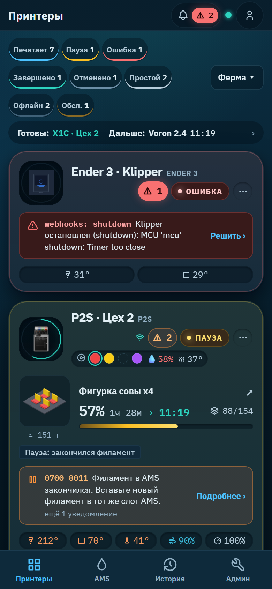</p>

<p align="center"><em>On a phone — one column, bottom navigation, popovers as bottom sheets.</em></p>

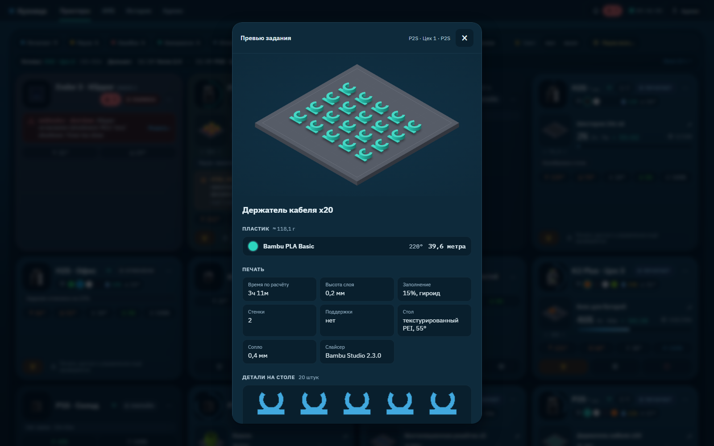

*Job card — the slicer's picture of the plate, each filament with colour, type,
grams and metres, the print settings and the parts on the plate, where an admin
skips a part mid-print.*

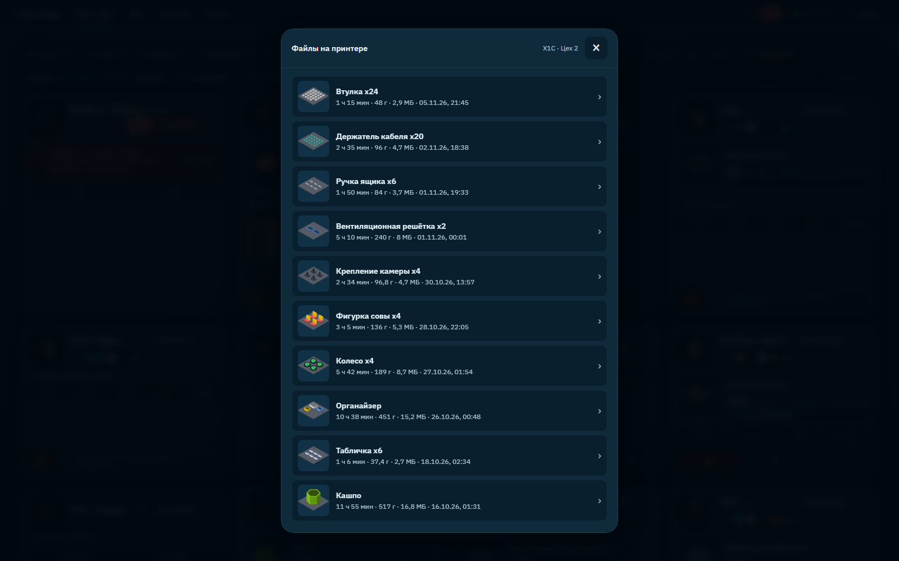

*Files on the printer — the print files stored on a Bambu or Creality printer,
and one opened to pick the plate and the AMS slots and start it.*

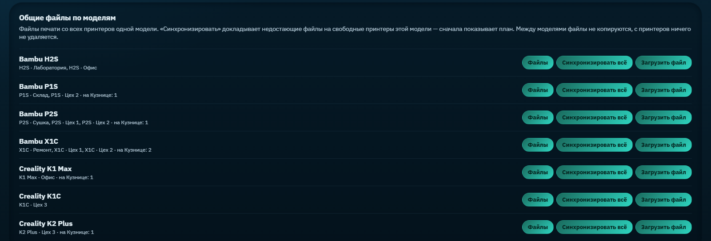

*Shared files by model — every file of a model's printers, which printer has
it, and the plan before the missing ones are copied.*

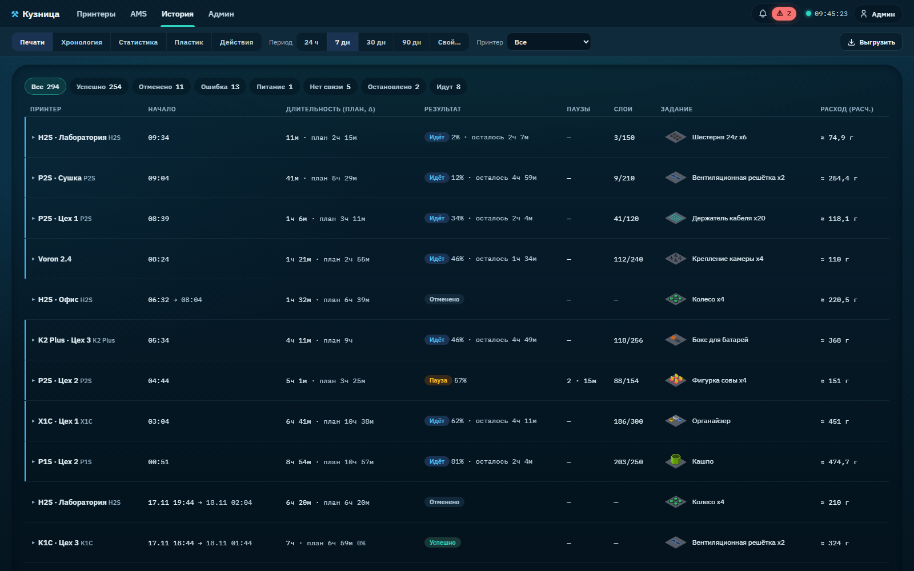

*History → Prints — one row per print: start, duration against the slicer's
plan, result, pauses, layers; chips filter by result.*

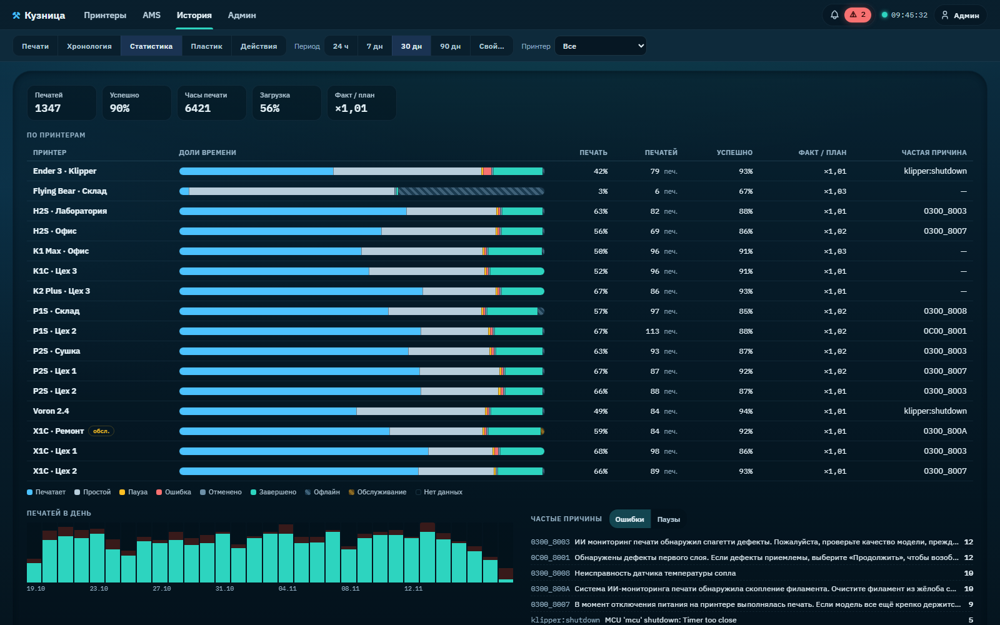

*History → Statistics — prints, success rate, print hours, load, the state
shares of every printer, prints per day and the most frequent errors.*

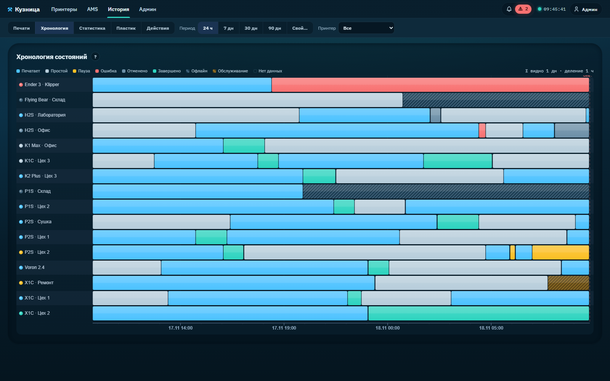

*History → Timeline — every printer's state over the chosen period.*

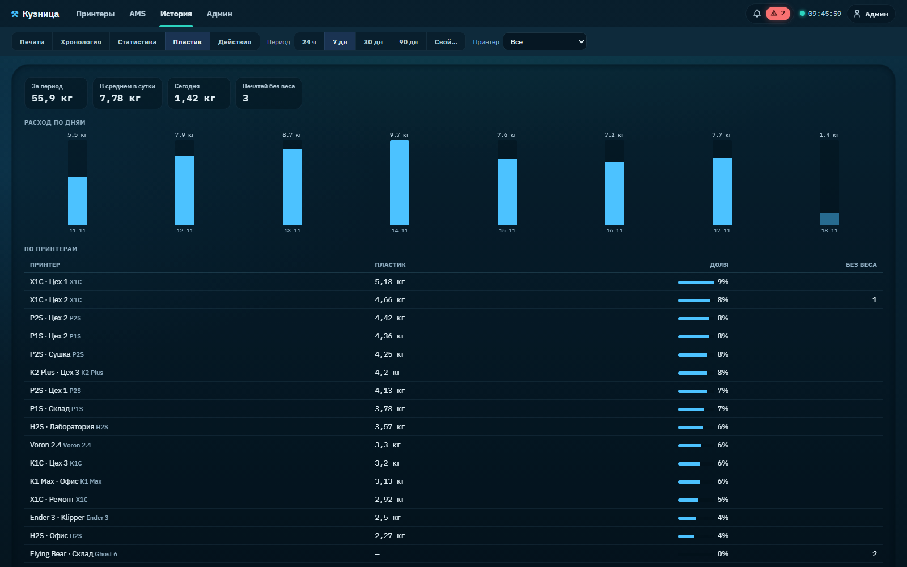

*History → Filament — the plastic used over the period, per day and per
printer, from the slicer's weight of each print.*

<p align="center">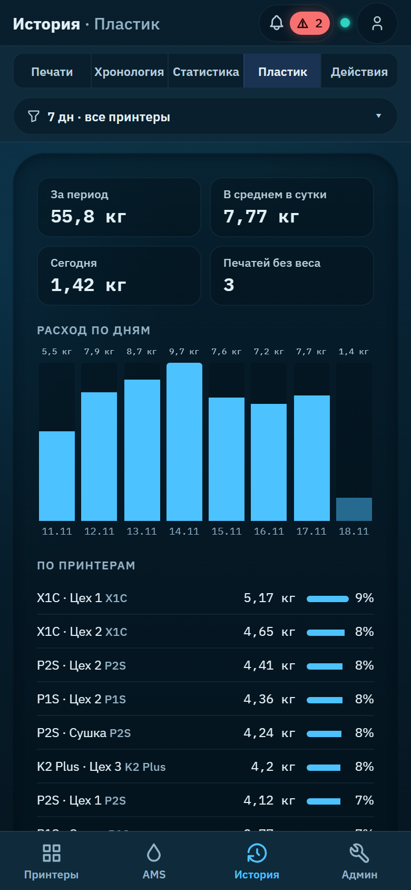 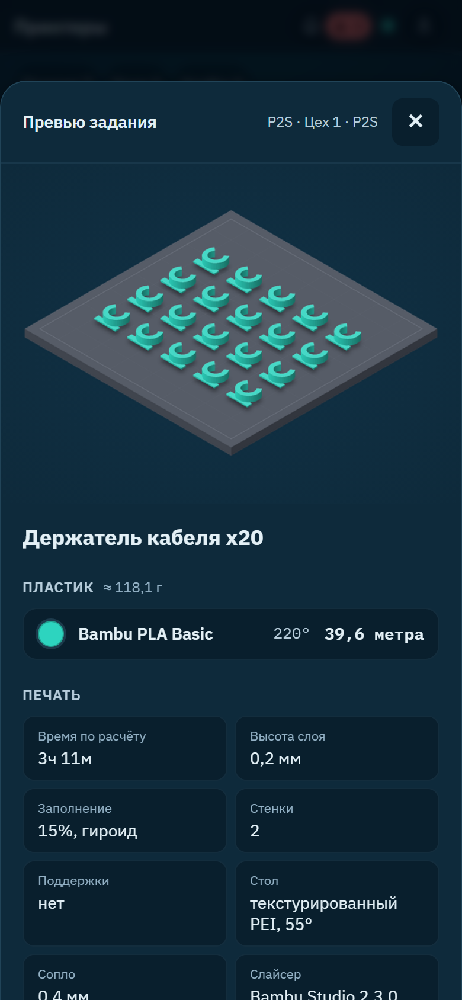</p>

<p align="center"><em>On a phone — History → Filament, and the job card as a bottom sheet.</em></p>

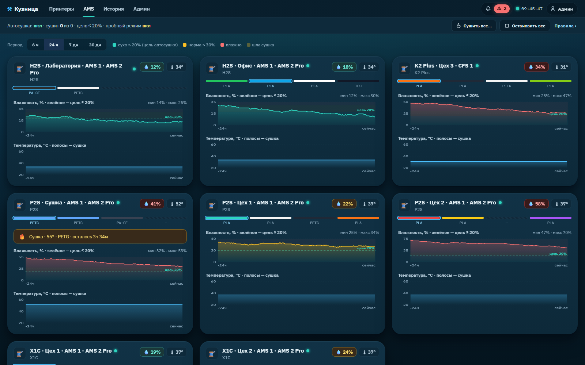

*AMS — humidity and temperature of every unit with drying periods, and the
auto-drying line on top.*

## Features

- **Unified live board** — every printer on one page: state, progress, ETA,
  nozzle/bed/chamber temperatures, the current job with the slicer's picture
  of the plate and its weight, Wi-Fi signal, AMS / CFS status, the official
  picture of each model. Cards follow live telemetry every 3 s; state chips
  filter the grid and the «Финиши» line shows which prints end next.
- **Job card for every print** — the slicer's picture of the plate, each
  filament with colour, type, profile, grams and metres, the slicer's time,
  layer height, infill, walls, supports and their weight, the bed,
  temperatures and the parts on the plate. Read from the job's own file (a
  Bambu 3MF from the printer's memory or storage, the Creality file list, the
  K2 Plus's G-code settings) and kept with the print in the history.
- **Skip parts mid-print** — click parts on the job card's plate map and skip
  them (Bambu with object labelling, Creality K2 Plus / K1C / Ender-5 Max);
  never all of them, checked against the running job.
- **Files on the printer** — list the print files stored on a Bambu or
  Creality printer (a USB stick on P2S / H2S, whose internal storage stays
  closed; the K2 Plus through Klipper's API) and start one from the panel with
  the plate, AMS slots, bed levelling and timelapse. Factory samples can be
  hidden.
- **Shared files by model** — upload a file once (or take it from one
  printer) and copy it to every printer of that model with one button: a plan
  first, progress per printer, never deleting or overwriting anything.
- **Plastic used** — History → Filament («Пластик»): the plastic used over the
  period, per day and per printer, from the slicer's weight of each print; a
  cancelled print counts the share it printed, a print over midnight is split
  by the hours it ran.
- **Four screens, phone-ready** — Printers · AMS · History · Admin (three for a
  viewer), each screen and sub-tab in the address so reloads and shared links
  keep it; on a phone a bottom navigation, popovers as bottom sheets and admin
  tables as cards. Installable as an app (PWA) with progress in the tab title.
- **Multi-protocol** — Bambu (MQTT), Creality and Klipper/Moonraker (WebSocket;
  a K2 Plus through both), and MKS WiFi, polled concurrently.
- **Printer notifications with actions** — every HMS message and print error on
  its card, the buttons Bambu Studio shows (from Bambu's own tables), each
  checked against the live printer before it is sent; a bell for what needs a
  decision; hide a lasting one; browser push notifications. Creality errors
  get «Сбросить ошибку» (clear the error) or «Перезапустить прошивку» (restart
  the firmware), as on the printer's own web page.
- **History** — a print journal (one row per print: plan vs actual, pauses and
  their reasons, result, the slicer's weight, the job card, CSV export for
  admins), a per-printer state timeline, statistics (fleet load, success rate,
  state durations), the plastic used and, for admins, an audit of every
  action.
- **Maintenance mode** — take a printer out of the fleet's counts, alerts,
  bulk commands and automation without losing its live status.
- **Temperature charts** — nozzle, bed and chamber over 6 h / 24 h / 7 d in the
  temperature chip's popover.
- **Telegram notifications** (optional, off by default) — alerts on finish /
  pause / error, with an outbound proxy pool, all editable from the UI.
- **Remote control** — a control row on every card for admins that follows
  the printer (printing: pause / stop; standing: cool down, bed down, move):
  light, pause/resume, stop, cool down, bed down, AMS and print speed on Bambu;
  pause/resume/stop, the light, cool down and bed down on Creality (K1 / K2
  series, Ender-5 Max); pause/resume/cancel and the light (an `output_pin`,
  found automatically) on Klipper. Home and axis jog on all three, filament
  push / retract at the nozzle on Bambu and Klipper. Nozzle, bed, fan, and
  speed control on Bambu and Creality, plus chamber temperature on models with
  an actively heated chamber (H2 series, K2 Plus / K2 Pro). AMS on Bambu: load and
  unload filament (idle printers only, checked against live telemetry), AMS 2
  Pro / AMS HT drying with Bambu Studio's temperature limits, «Катушки…»
  (spools: re-read a slot's tag or set its spool by hand) and the AMS refill
  settings the printer reports; the air duct mode on P2S / H2. Creality:
  chamber temperature, the CFS laid out like the AMS (load / unload, tags,
  spools, refill setting), model-specific limits, and on a K2 Plus its
  calibrations and firmware restart. The lamp goes on by itself when a
  printer pauses, fails or is cancelled. Each control appears only where the
  printer can carry it out (the firmware's acceptance is read from the
  printer's reports, or probed), the server refuses commands the printer's live
  state forbids (no cooling or bed move mid-print), and the card shows each
  printer's answer. A fleet bar switches every light at once and pauses or
  resumes chosen printers.
- **AMS auto-drying** — dries an AMS 2 Pro / AMS HT by time when its humidity
  at rest stays high, measures again once the unit has cooled, and repeats up
  to a limit; never stops a drying itself, leaves drying started elsewhere
  alone, and starts in a journal-only shadow mode (rules on the AMS tab).
- **Auth & roles** — JWT cookie sessions, `admin` and `viewer` roles, login rate
  limiting (5 failures per address; past 10 failures per login name a growing
  1–30 s delay, the right password still gets in), refresh-token rotation, and
  an audit log.
- **Fleet managed from the UI** — add, edit, and remove printers in the admin
  panel; no code edits or redeploys to change the fleet.

## Tech stack

- **Backend:** Python 3 + [FastAPI](https://fastapi.tiangolo.com/) / Uvicorn
- **Frontend:** vanilla JavaScript, HTML, and CSS (no build step)
- **Storage:** SQLite (`printer_history.db` for fleet/settings/history,
  `users.db` for accounts/audit, `ams_history.db` for AMS humidity) and `data/`
  (job previews and cards, the shared file pool)
- **Printer libraries:** a vendored copy of `pybambu` from
  [ha-bambulab](https://github.com/greghesp/ha-bambulab) (Bambu; MIT,
  `app/vendor/pybambu`), a standalone client copied from
  [ha_creality_ws](https://github.com/3dg1luk43/ha_creality_ws) (Creality;
  AGPL-3.0, `app/vendor/ha_creality_ws`), `websocket-client` (Klipper), plus a
  small MKS WiFi client
- **Bot:** `aiogram` for Telegram

## Requirements

- **Host:** Linux, macOS, or Windows with Python 3.11+ (or just Docker).
- **Network:** the host must be able to reach each printer over your LAN.
  Printers are polled directly — Bambu over MQTT (TLS 8883), Creality and
  Klipper/Moonraker over WebSocket, MKS over its WiFi HTTP/TCP port. Put the
  host and the printers on the same subnet/VLAN (or route/firewall between
  them accordingly). No cloud account is used.
- **Per printer:** for Bambu you need the machine's **access code** and
  **serial**, and the printer in **LAN Mode**. Creality/Klipper/MKS just need
  the host/IP.

## Quick start

### Docker (recommended)

```bash
git clone <your-fork-url> kuznitsa && cd kuznitsa
touch printer_history.db users.db ams_history.db   # so Docker mounts them as files
mkdir -p data                          # job previews and cards, the shared file pool
docker compose up -d --build
docker compose logs -f                 # read the first-run admin password once
```

Open `http://<host>:8000` and log in as `admin`. Databases and `data/` persist in
the repo directory; `git pull` and `docker compose up -d --build` pick up new
versions (run the `touch` and `mkdir` lines again first: older versions did not
mount `ams_history.db` and `data/`). To keep the previews and pool files of such
an older container, copy them out before the rebuild:
`docker cp kuznitsa:/app/data/. ./data/`.

**Exposure.** `docker-compose.yml` publishes port 8000 on **all** interfaces
with `COOKIE_SECURE=0` — meant for a trusted LAN. Docker writes its own iptables
rules, so **ufw / firewalld rules do not block that port**. If the host is
reachable from the internet, or nginx/Caddy on the host serves HTTPS, publish
the port on loopback only (`"127.0.0.1:8000:8000"`) and set `COOKIE_SECURE=1`.

**Docker behind nginx/Caddy on the host.** The proxy connects to the published
port, so inside the container every request comes from the Docker bridge
gateway (e.g. `172.18.0.1` — `docker compose logs` shows it in the access log),
not from `127.0.0.1`. The dashboard then ignores `X-Real-IP` and sees all users
as one address: five wrong passwords from anyone lock everyone out for 15
minutes. Trust the gateway:

```yaml
    environment:
      - FORGE_TRUSTED_PROXIES=172.18.0.1    # your gateway; or a network: 172.16.0.0/12
```

Trust only the address your proxy really comes from: whoever connects from a
trusted address can set any client IP.

### From source

```bash
git clone <your-fork-url> kuznitsa
cd kuznitsa

python -m venv .venv
. .venv/bin/activate            # Windows: .venv\Scripts\activate
pip install -r requirements.txt

cp .env.example .env            # optional — see below
python main.py
```

`main.py` reads `.env` from the project root at start (no extra package needed):
`KEY=VALUE` lines, `#` comments, optional quotes. A variable already set in the
environment (systemd `Environment=`, Docker `environment:`, `export`) wins.

Then open the dashboard (default `http://127.0.0.1:8000`).

### First-run admin

On first boot, with no users in the database, an `admin` account is created:

- If you set `FORGE_ADMIN_USERNAME` / `FORGE_ADMIN_PASSWORD`, those are used.
- Otherwise a **random password is generated and printed once to the log** —
  read it there, log in, and change it immediately from the UI.

### Adding printers

Log in as admin, open **Admin → Park** («Админ → Парк»), and add each machine (kind, label,
host; for Bambu also the access code and serial). Changes are stored in the
database; click **Apply** to restart the poller onto the new fleet. Nothing about
your fleet lives in the source tree.

### Configuration

All runtime configuration is optional and has safe defaults. See
[`.env.example`](./.env.example) for the full list. Highlights:

| Variable | Default | Purpose |
| --- | --- | --- |
| `FORGE_JWT_SECRET` | auto-generated & persisted | JWT signing key |
| `FORGE_ADMIN_USERNAME` | `admin` | First-run admin username |
| `FORGE_ADMIN_PASSWORD` | random (logged once) | First-run admin password |
| `COOKIE_SECURE` | `1` | Send auth cookies over HTTPS only (over plain `http://` the browser then drops them — the login page says so) |
| `FORGE_TRUSTED_PROXIES` | `127.0.0.1,::1` | IPs / CIDR networks of reverse proxies whose `X-Real-IP` / `X-Forwarded-For` is trusted |
| `WEB_HOST` / `WEB_PORT` | `127.0.0.1` / `8000` | Server bind address |
| `POLL_INTERVAL` / `MAX_WORKERS` | `5` (30 s at least) / `10` | Full poll cadence (history, journal, notifications) / concurrency |
| `FORGE_LIVE_REFRESH_S` | `2` | Live card refresh from the printers' telemetry; `0` = off |
| `FORGE_BAMBU_TLS_VERIFY` | empty (off) | Verify Bambu printer TLS certificates against Bambu's CAs: `*` or comma-separated models |
| `HISTORY_RETENTION_DAYS` / `JOBS_RETENTION_DAYS` | `90` / `730` | Days of state / AMS history and of the print journal |
| `FORGE_TZ_OFFSET_MIN` | `180` | Farm time zone for the auto-drying window, minutes from UTC |
| `FORGE_DATA_DIR` | the project root | Folder with the three databases and `data/`; changing it moves no files |
| `FORGE_FILE_POOL_MAX_GB` / `FORGE_FILE_POOL_FILE_MAX_MB` | `8` / `512` | Shared file pool on the panel: all uploads together / one file |
| `FORGE_FILE_POOL_KEEP_FREE_MB` | `1024` | Uploads to the pool stop while the panel's disk has less free space than this |

The **Telegram bot token, chat id, notification templates, and proxy list** are
managed in the database and edited from **Admin → System** in the UI — not via env or
code. A Creality without a controllable lamp (no `lightSw`, e.g. K1 SE) is
switched off with **Allow light control** in its printer form (stored as
`printer_light_disabled`). One expert setting has no UI: `auto_light_states`,
the states that switch a printer's lamp on when it steps into them (default
`["paused", "error", "cancelled"]`; `finished` is allowed too, `[]` turns it
off), set with `PUT /api/admin/settings`
`{"auto_light_states": ["paused", "error"]}`.

Run behind a TLS reverse proxy (e.g. nginx) in production and keep
`COOKIE_SECURE=1`. Serve the app with a process manager such as a systemd
unit; bind it to `127.0.0.1` and let the proxy terminate TLS.

Ready-to-adapt examples (placeholders, no real hosts) live in
[`deploy/`](./deploy/): a systemd unit (`bambudiagnostic.service`) with an
installer (`install_service.sh`), an nginx TLS vhost (`nginx-bambu.conf`), a
self-signed HTTPS bootstrap (`setup_https.sh`), a nightly backup to a separate
disk (`forge_db_backup.py` with `forge-db-backup.service` / `.timer`: the three
databases, `config.py` and `data/job_previews/`, unchanged previews hard-linked
to the night before), and an optional SSH reverse-tunnel unit for exposing a
LAN instance through a public VPS.

## Running the tests

```bash
pip install -r requirements.txt pytest httpx    # httpx: FastAPI's TestClient needs it
python -m pytest -q
```

## Русский (кратко)

Самостоятельно размещаемая панель мониторинга фермы 3D-принтеров: Bambu Lab,
Creality, Klipper/Moonraker и MKS WiFi на одной странице — состояние, прогресс,
картинка задания из слайсера и его вес, температуры (с графиками), уведомления
принтеров с кнопками как в Bambu Studio, карточка каждой печати (пластики,
настройки печати, детали на столе, пропуск деталей на ходу), файлы на принтере
с запуском печати, общие файлы по моделям, журнал печатей, хронология,
статистика и расход пластика по дням и принтерам, режим обслуживания,
управление с карточки (в том числе «Домой», перемещение осей, CFS у Creality),
групповые команды «Вся ферма» (свет, пауза, продолжение) и автосушка
AMS по влажности в покое. Четыре экрана — Принтеры · AMS · История · Админ, на
телефоне нижняя навигация, ставится как приложение (PWA). Парк
принтеров, токен Telegram и прокси задаются в веб-интерфейсе (хранятся в БД), а
не в коде. Быстрый старт и переменные окружения — см. разделы выше и
[`.env.example`](./.env.example).

## License

This project is dual-licensed:

- **Open source:** [GNU AGPL-3.0](./LICENSE). Network use triggers the
  source-disclosure obligation — if you host a modified version, share your
  source.
- **Commercial:** a separate license is available for closed-source / SaaS use —
  see [`COMMERCIAL-LICENSE.md`](./COMMERCIAL-LICENSE.md).

Contributions are accepted under the CLA in [`CONTRIBUTING.md`](./.github/CONTRIBUTING.md).

### Third-party code

[`app/vendor/pybambu/`](./app/vendor/pybambu/) is a vendored copy of the `pybambu`
library from [ha-bambulab](https://github.com/greghesp/ha-bambulab), licensed
under the MIT License, © 2023 ha-bambulab contributors (see its
[`LICENSE`](./app/vendor/pybambu/LICENSE) and
[`VENDORED.md`](./app/vendor/pybambu/VENDORED.md)). It stays under the MIT
License and is not covered by the dual-licensing grant above.

[`app/vendor/ha_creality_ws/`](./app/vendor/ha_creality_ws/) is the standalone
Creality client copied from
[ha_creality_ws](https://github.com/3dg1luk43/ha_creality_ws), licensed under
the AGPL-3.0 (see its [`LICENSE`](./app/vendor/ha_creality_ws/LICENSE) and
[`VENDORED.md`](./app/vendor/ha_creality_ws/VENDORED.md)). It stays under the
AGPL-3.0 and is not covered by the dual-licensing grant above.
