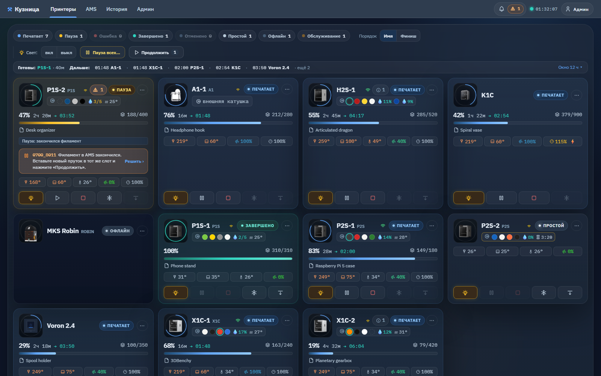
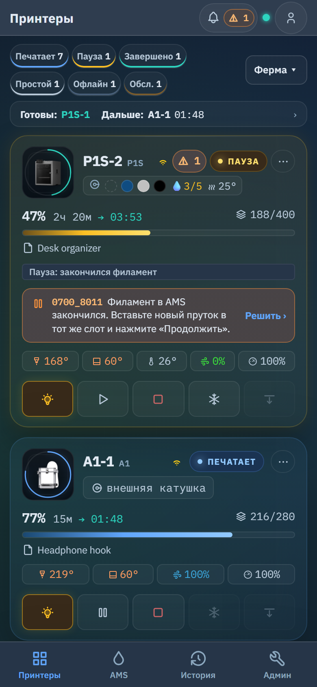
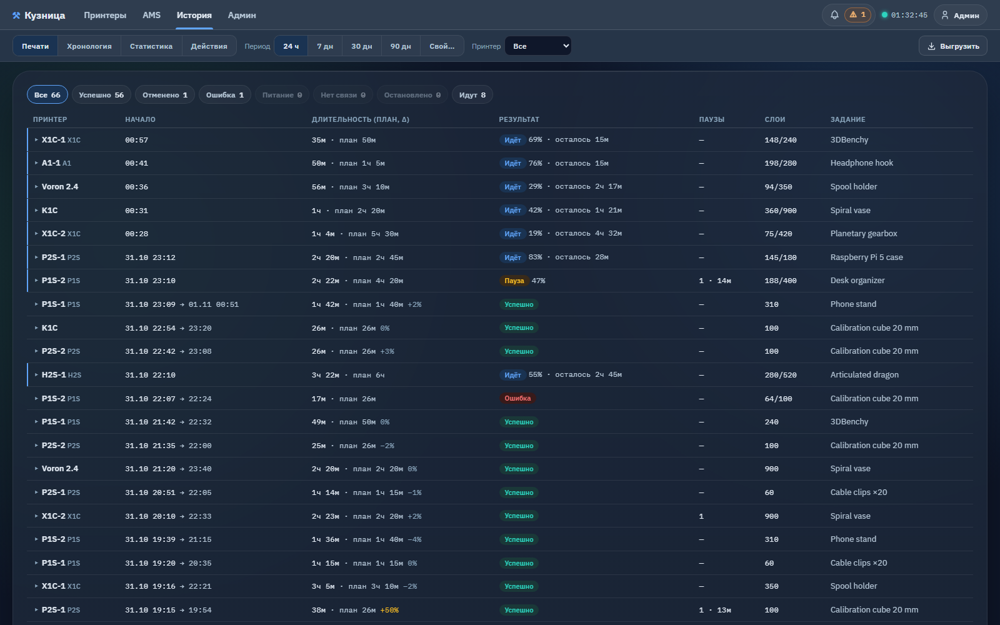
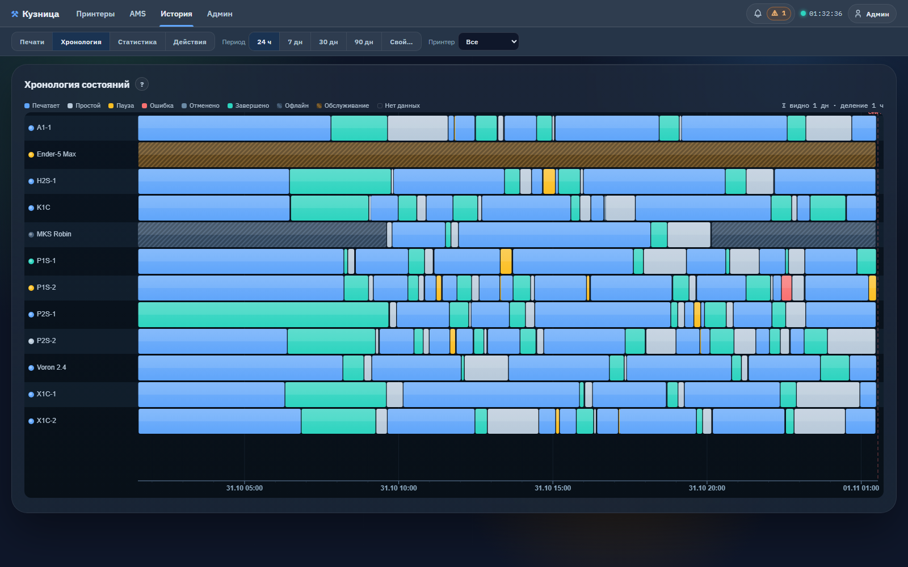
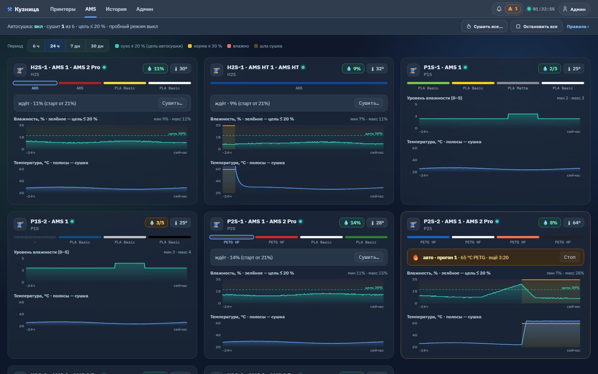

# Kuznitsa — Self-Hosted 3D-Printer Farm Dashboard

📖 **Documentation (English / Русский): https://mihey-web.github.io/printer-fleet-dashboard/**

A lightweight, self-hosted dashboard for monitoring and controlling a mixed fleet
of 3D printers from one web page. Built for print farms that run more than one
brand of machine and want a single, always-on status board with history,
notifications, and basic remote control.

Supports **Bambu Lab**, **Creality** (K1 series / Sonic Pad), **Klipper /
Moonraker**, and **MKS WiFi** printers side by side.

*All screenshots use a synthetic demo farm — no real printers or jobs.*



*Printers — every printer on one page: state, progress, ETA, temperatures, AMS
slots and humidity, the notification that needs a decision with its action,
state chips, which prints finish next, and the admin's control row.*

<p align="center"></p>

<p align="center"><em>On a phone — one column, bottom navigation, popovers as bottom sheets.</em></p>



*History → Prints — one row per print: start, duration against the slicer's
plan, result, pauses, layers; chips filter by result.*


*History → Statistics — prints, success rate, print hours, load, the state
shares of every printer, prints per day and the most frequent errors.*



*History → Timeline — every printer's state over the chosen period.*



*AMS — humidity and temperature of every unit with drying periods, and the
auto-drying line on top.*

## Features

- **Unified live board** — every printer on one page: state, progress, ETA,
  nozzle/bed/chamber temperatures, current job, Wi-Fi signal, AMS status.
  Cards follow live telemetry every 2 s; state chips filter the grid and the
  «Финиши» line shows which prints end next.
- **Four screens, phone-ready** — Printers · AMS · History · Admin (three for a
  viewer), each screen and sub-tab in the address so reloads and shared links
  keep it; on a phone a bottom navigation, popovers as bottom sheets and admin
  tables as cards. Installable as an app (PWA) with progress in the tab title.
- **Multi-protocol** — Bambu (MQTT), Creality and Klipper/Moonraker (WebSocket),
  and MKS WiFi, polled concurrently.
- **Printer notifications with actions** — every HMS message and print error on
  its card, the buttons Bambu Studio shows (from Bambu's own tables), each
  checked against the live printer before it is sent; a bell for what needs a
  decision; hide a lasting one; browser push notifications.
- **History** — a print journal (one row per print: plan vs actual, pauses and
  their reasons, result, CSV export for admins), a per-printer state timeline,
  statistics (fleet load, success rate, state durations) and, for admins, an
  audit of every action.
- **Maintenance mode** — take a printer out of the fleet's counts, alerts,
  bulk commands and automation without losing its live status.
- **Temperature charts** — nozzle, bed and chamber over 6 h / 24 h / 7 d in the
  temperature chip's popover.
- **Telegram notifications** (optional, off by default) — alerts on finish /
  pause / error, with an outbound proxy pool, all editable from the UI.
- **Remote control** — a control row on every card for admins: light,
  pause/resume, stop, cool down, bed down, AMS and print speed on Bambu;
  pause/resume/stop, the light and cool down on Creality (K1 series, Ender-5
  Max); pause/resume/cancel and the light (an `output_pin`, found
  automatically) on Klipper. Nozzle, bed, fan, and speed control on Bambu and
  Creality, plus chamber temperature on models with an actively heated
  chamber (H2 series). AMS on Bambu: load and unload filament (idle printers
  only, checked against live telemetry) and AMS 2 Pro / AMS HT drying with
  Bambu Studio's temperature limits. Each control appears only where the
  printer can carry it out (the firmware's acceptance is read from the
  printer's reports, or probed), the server refuses commands the printer's live
  state forbids (no cooling or bed move mid-print), and the card shows each
  printer's answer. A fleet bar switches every light at once and pauses or
  resumes chosen printers.
- **AMS auto-drying** — dries an AMS 2 Pro / AMS HT by time when its humidity
  at rest stays high, measures again once the unit has cooled, and repeats up
  to a limit; never stops a drying itself, leaves drying started elsewhere
  alone, and starts in a journal-only shadow mode (rules on the AMS tab).
- **Auth & roles** — JWT cookie sessions, `admin` and `viewer` roles, login rate
  limiting, refresh-token rotation, and an audit log.
- **Fleet managed from the UI** — add, edit, and remove printers in the admin
  panel; no code edits or redeploys to change the fleet.

## Tech stack

- **Backend:** Python 3 + [FastAPI](https://fastapi.tiangolo.com/) / Uvicorn
- **Frontend:** vanilla JavaScript, HTML, and CSS (no build step)
- **Storage:** SQLite (`printer_history.db` for fleet/settings/history,
  `users.db` for accounts/audit)
- **Printer libraries:** a vendored copy of `pybambu` from
  [ha-bambulab](https://github.com/greghesp/ha-bambulab) (Bambu; MIT,
  `app/vendor/pybambu`), `websocket-client` (Creality / Klipper), plus a small
  MKS WiFi client
- **Bot:** `aiogram` for Telegram

## Requirements

- **Host:** Linux, macOS, or Windows with Python 3.11+ (or just Docker).
- **Network:** the host must be able to reach each printer over your LAN.
  Printers are polled directly — Bambu over MQTT (TLS 8883), Creality and
  Klipper/Moonraker over WebSocket, MKS over its WiFi HTTP/TCP port. Put the
  host and the printers on the same subnet/VLAN (or route/firewall between
  them accordingly). No cloud account is used.
- **Per printer:** for Bambu you need the machine's **access code** and
  **serial**, and the printer in **LAN Mode**. Creality/Klipper/MKS just need
  the host/IP.

## Quick start

### Docker (recommended)

```bash
git clone <your-fork-url> kuznitsa && cd kuznitsa
touch printer_history.db users.db      # so Docker mounts them as files
docker compose up -d --build
docker compose logs -f                 # read the first-run admin password once
```

Open `http://<host>:8000` and log in as `admin`. Databases persist in the repo
directory; `docker compose pull`/`up --build` picks up new versions.

### From source

```bash
git clone <your-fork-url> kuznitsa
cd kuznitsa

python -m venv .venv
. .venv/bin/activate            # Windows: .venv\Scripts\activate
pip install -r requirements.txt

cp .env.example .env            # optional — see below
python main.py
```

Then open the dashboard (default `http://127.0.0.1:8000`).

### First-run admin

On first boot, with no users in the database, an `admin` account is created:

- If you set `FORGE_ADMIN_USERNAME` / `FORGE_ADMIN_PASSWORD`, those are used.
- Otherwise a **random password is generated and printed once to the log** —
  read it there, log in, and change it immediately from the UI.

### Adding printers

Log in as admin, open **Admin → Park** («Админ → Парк»), and add each machine (kind, label,
host; for Bambu also the access code and serial). Changes are stored in the
database; click **Apply** to restart the poller onto the new fleet. Nothing about
your fleet lives in the source tree.

### Configuration

All runtime configuration is optional and has safe defaults. See
[`.env.example`](./.env.example) for the full list. Highlights:

| Variable | Default | Purpose |
| --- | --- | --- |
| `FORGE_JWT_SECRET` | auto-generated & persisted | JWT signing key |
| `FORGE_ADMIN_USERNAME` | `admin` | First-run admin username |
| `FORGE_ADMIN_PASSWORD` | random (logged once) | First-run admin password |
| `COOKIE_SECURE` | `1` | Send auth cookies over HTTPS only |
| `WEB_HOST` / `WEB_PORT` | `127.0.0.1` / `8000` | Server bind address |
| `POLL_INTERVAL` / `MAX_WORKERS` | `5` (30 s at least) / `10` | Full poll cadence (history, journal, notifications) / concurrency |
| `FORGE_LIVE_REFRESH_S` | `2` | Live card refresh from the printers' telemetry; `0` = off |
| `FORGE_BAMBU_TLS_VERIFY` | empty (off) | Verify Bambu printer TLS certificates against Bambu's CAs: `*` or comma-separated models |

The **Telegram bot token, chat id, notification templates, and proxy list** are
managed in the database and edited from **Admin → System** in the UI — not via env or
code. One expert setting has no UI: `printer_light_disabled`, a list of
Creality printer ids without a controllable lamp (no `lightSw`, e.g. K1 SE),
whose light button is hidden, set with `PUT /api/admin/settings`
`{"printer_light_disabled": ["<printer id>"]}`.

Run behind a TLS reverse proxy (e.g. nginx) in production and keep
`COOKIE_SECURE=1`. Serve the app with a process manager such as a systemd
unit; bind it to `127.0.0.1` and let the proxy terminate TLS.

Ready-to-adapt examples (placeholders, no real hosts) live in
[`deploy/`](./deploy/): a systemd unit (`bambudiagnostic.service`) with an
installer (`install_service.sh`), an nginx TLS vhost (`nginx-bambu.conf`), a
self-signed HTTPS bootstrap (`setup_https.sh`), and an optional SSH
reverse-tunnel unit for exposing a LAN instance through a public VPS.

## Running the tests

```bash
pip install pytest
python -m pytest -q
```

## Русский (кратко)

Самостоятельно размещаемая панель мониторинга фермы 3D-принтеров: Bambu Lab,
Creality, Klipper/Moonraker и MKS WiFi на одной странице — состояние, прогресс,
температуры (с графиками), уведомления принтеров с кнопками как в Bambu Studio,
журнал печатей, хронология и статистика, режим обслуживания, управление с
карточки, групповые команды «Вся ферма» (свет, пауза, продолжение) и автосушка
AMS по влажности в покое. Четыре экрана — Принтеры · AMS · История · Админ, на
телефоне нижняя навигация, ставится как приложение (PWA). Парк
принтеров, токен Telegram и прокси задаются в веб-интерфейсе (хранятся в БД), а
не в коде. Быстрый старт и переменные окружения — см. разделы выше и
[`.env.example`](./.env.example).

## License

This project is dual-licensed:

- **Open source:** [GNU AGPL-3.0](./LICENSE). Network use triggers the
  source-disclosure obligation — if you host a modified version, share your
  source.
- **Commercial:** a separate license is available for closed-source / SaaS use —
  see [`COMMERCIAL-LICENSE.md`](./COMMERCIAL-LICENSE.md).

Contributions are accepted under the CLA in [`CONTRIBUTING.md`](./.github/CONTRIBUTING.md).

### Third-party code

[`app/vendor/pybambu/`](./app/vendor/pybambu/) is a vendored copy of the `pybambu`
library from [ha-bambulab](https://github.com/greghesp/ha-bambulab), licensed
under the MIT License, © 2023 ha-bambulab contributors (see its
[`LICENSE`](./app/vendor/pybambu/LICENSE) and
[`VENDORED.md`](./app/vendor/pybambu/VENDORED.md)). It stays under the MIT
License and is not covered by the dual-licensing grant above.
