# Kuznitsa

**Kuznitsa** (Russian «Кузница», "the forge") is a dashboard for a 3D-printer farm that you run on
your own computer. One web page shows every printer of the farm — of different brands — with its
state, progress, temperatures, AMS, notifications and history, and lets an administrator control
the printers remotely.

- It works inside your local network: the dashboard talks to each printer directly. No cloud
  account is used.
- It is free and open source (AGPL-3.0); a commercial license is also available — see
  [License](license.md).
- This documentation describes **version 2.2.0** (released 18 November 2026).

!!! note "Russian and English labels"
    The dashboard speaks Russian and English (switch it in 👤 → *This browser*). Russian is its
    source language, so in this guide every button and screen is given in English with the
    **exact Russian label in brackets**, for example *Admin → Fleet* («Админ → Парк»): you can find
    it on the screen in either language.

## Supported printers

| Brand | Models offered in the "add printer" form | How the dashboard connects |
| --- | --- | --- |
| **Bambu Lab** | X1, X1 Carbon, X1E, P1P, P1S, P2S, A1, A1 mini, A2L, H2C, H2D, H2D Pro, H2S, X2D | MQTT over TLS, port 8883 (8884 is tried too) |
| **Creality** | K1 / K2, Ender-3 V3 / V3 KE / V3 Plus, Ender-5 Max, CR-10 SE, Hi, SPARKX i7 and compatible models | WebSocket, port 9999; one that also answers on Klipper's API (Moonraker, port 7125), such as the K2 Plus, through it too — found by itself |
| **Klipper / Moonraker** | any — the model is free text | Moonraker WebSocket, port 7125 by default |
| **MKS WiFi** | any — the model is free text | G-code over TCP, port 8080 by default |

What each brand needs and where to find it is on [Adding printers](printers.md).

## What it can do

- **One live board** — every printer on one page: state, progress, time left, nozzle / bed /
  chamber temperatures, the current job with the slicer's picture and weight, Wi-Fi signal, AMS or
  CFS. Cards follow live data every 3 s.
- **Four screens** — Printers («Принтеры»), AMS, History («История»), Admin («Админ»). A viewer
  sees three of them (no Admin). On a phone there is a bottom navigation bar; the dashboard can be
  installed as an app (PWA).
- **A job card for every print** — the slicer's picture of the plate, each filament with its
  colour, type, grams and metres, the print settings and the parts on the plate; kept in the
  history. Administrators can skip single parts mid-print from its plate map (Bambu and Creality).
- **Files on the printer** — list the print files stored on a Bambu or Creality printer and start
  one from the dashboard; **shared files by model** put the same files on every printer of a model
  with one button.
- **Printer notifications with actions** — every Bambu HMS message and print error appears on the
  printer's card, with the same buttons Bambu Studio shows; Creality errors can be cleared or the
  firmware restarted from the panel.
- **History** — a print journal (one row per print), a state timeline, statistics, the plastic
  used per day and per printer and, for administrators, a log of every action.
- **Maintenance mode** — take a printer out of the farm's counts, alerts and automation without
  losing its live status.
- **Temperature charts** — nozzle, bed and chamber for 6 h / 24 h / 7 days.
- **Telegram notifications** (optional, off by default) — on finish, pause or error, through a
  proxy if needed.
- **Remote control** for administrators — light, pause / resume, stop, cool down, bed down,
  temperatures, fans, speed; home, axis jog and filament push / retract; AMS filament load / unload,
  drying and spools on Bambu, the air duct mode on P2S / H2; CFS slots on Creality. Each button
  appears only where the printer supports it. The lamp goes on by itself when a printer stops.
- **AMS auto-drying** — dries an AMS 2 Pro / AMS HT when its humidity stays high. It ships in a
  trial mode that only writes a journal.
- **Users and roles** — administrator («Админ») and viewer («Зритель»), with login protection and
  an action log.
- **The fleet is managed from the web page** — add, edit and remove printers without touching
  files.

## Screenshots

All screenshots use a synthetic demo farm — no real printers or jobs.

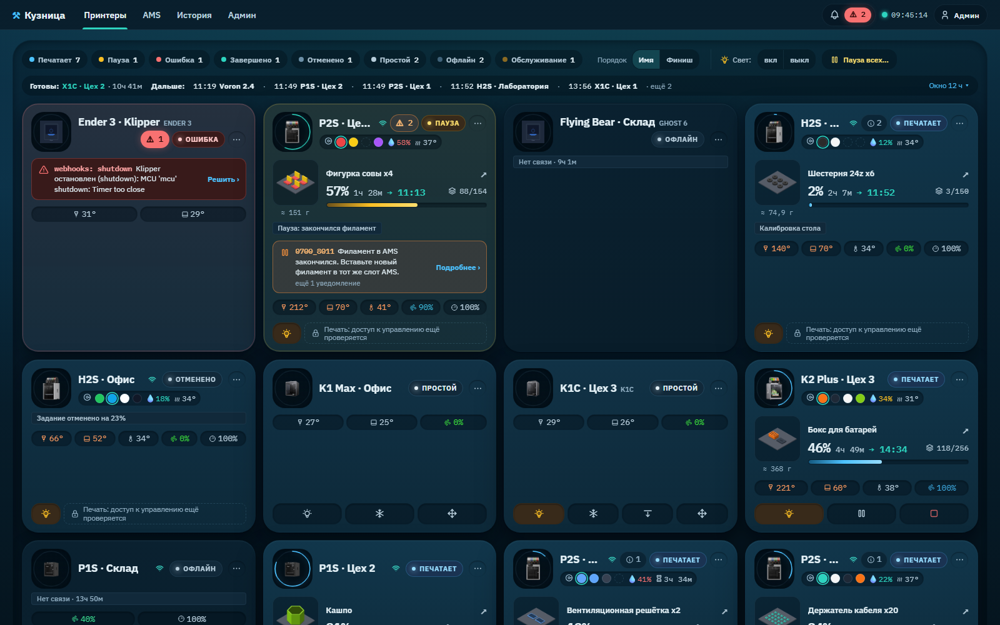

*Printers («Принтеры») — every printer on one page: state, progress, the job's picture and weight,
time left, temperatures, AMS slots and humidity, the notification that needs a decision, state
chips, the next finishes and the administrator's control row.*

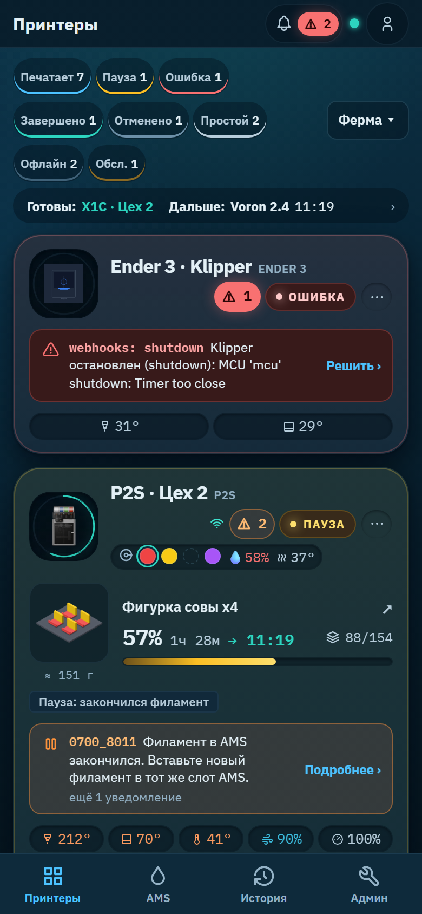

*On a phone — one column, bottom navigation, pop-ups as bottom sheets.*

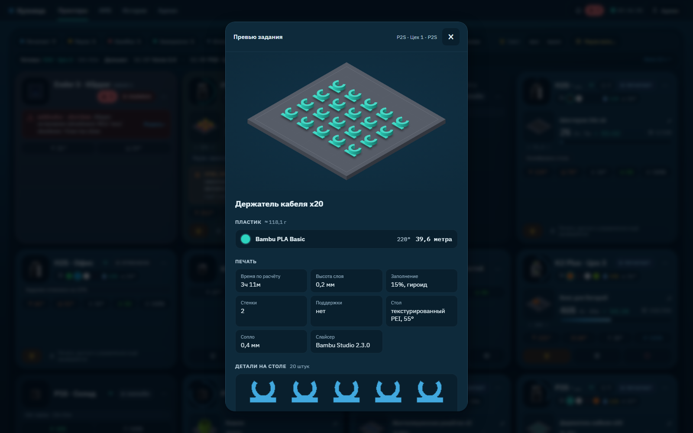

*The job card («Превью задания») — the slicer's picture of the plate, each filament with its weight,
the print settings and the parts on the plate, where an administrator can skip a part mid-print.*

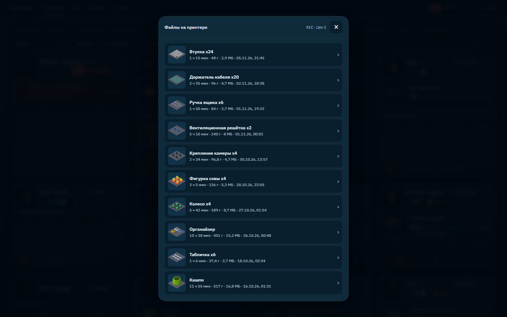

*Files on the printer («Файлы на принтере») — the files stored on the printer, and a file opened to
pick the plate and the AMS slots and start it.*

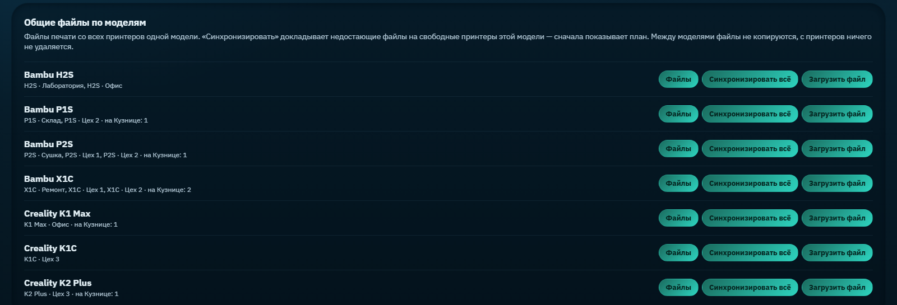

*Shared files by model («Общие файлы по моделям») — every file of a model's printers, which printer
has it, and the plan before copying the missing ones.*

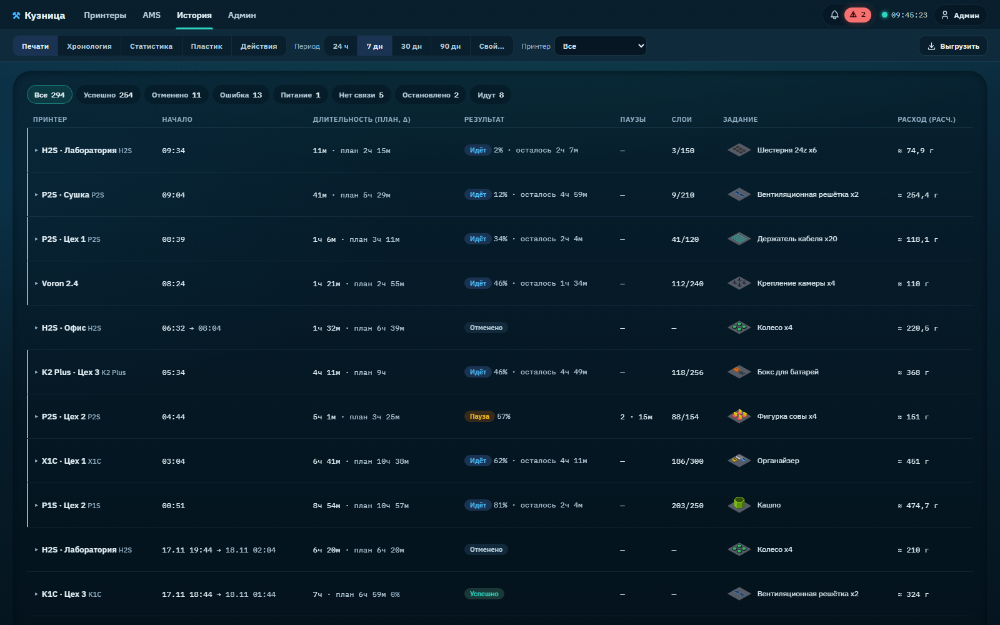

*History → Prints («История → Печати») — one row per print: start, duration against the slicer's
plan, result, pauses, layers.*

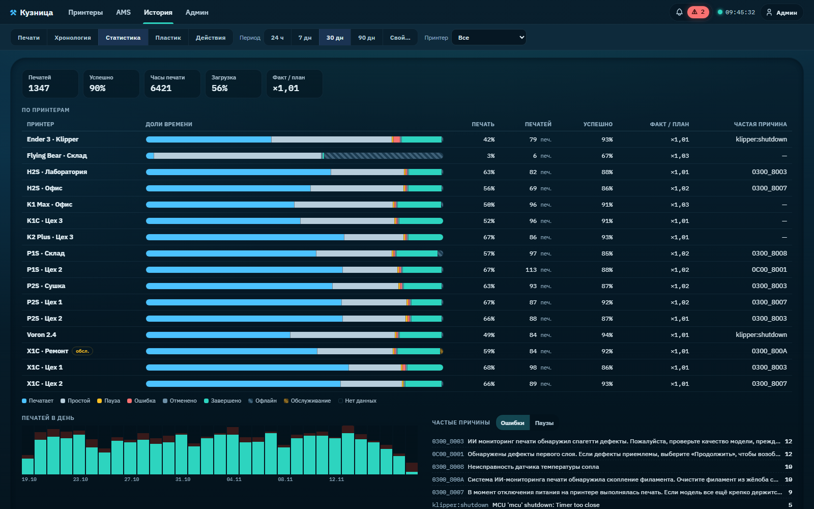

*History → Statistics («История → Статистика») — prints, success rate, print hours, load, state
shares per printer, prints per day, most frequent errors.*

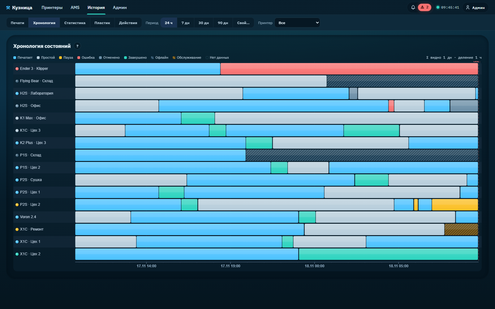

*History → Timeline («История → Хронология») — every printer's state over the chosen period.*

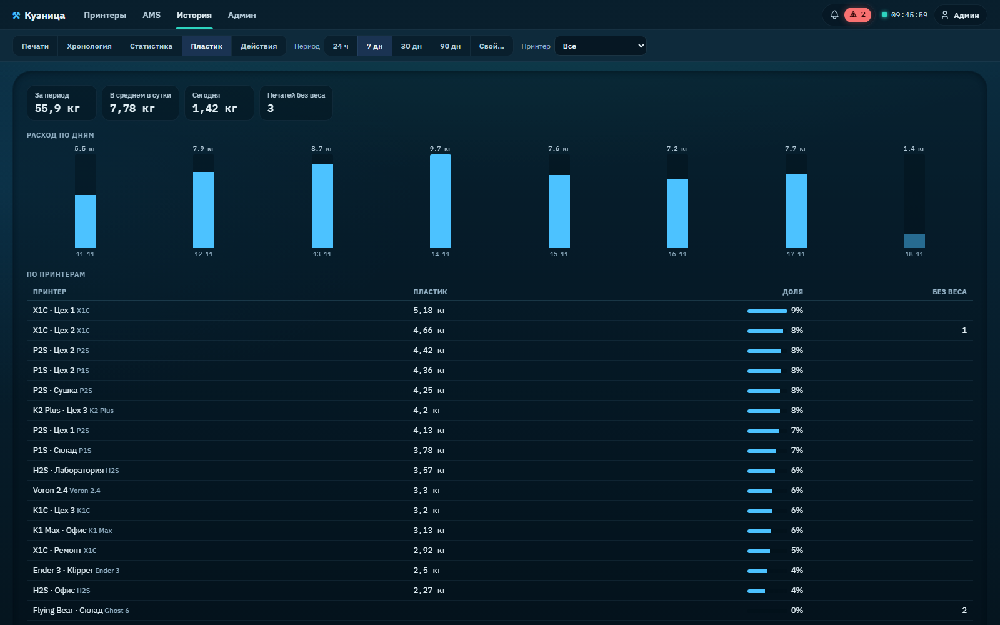

*History → Filament («История → Пластик») — the plastic used over the period, per day and per
printer, from the slicer's weight of each print.*

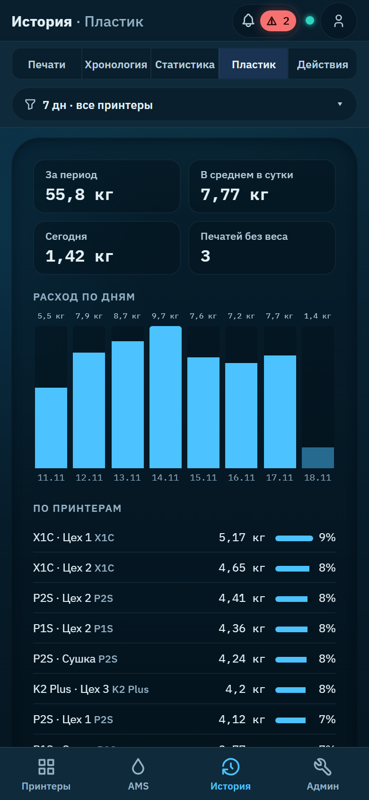 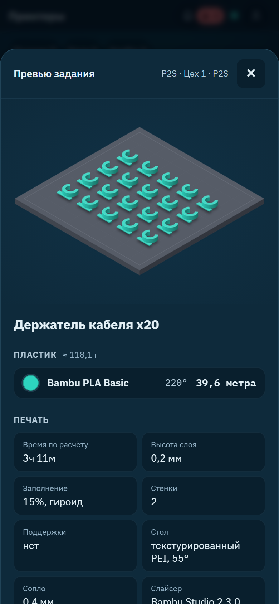

*On a phone — History → Filament, and the job card as a bottom sheet.*

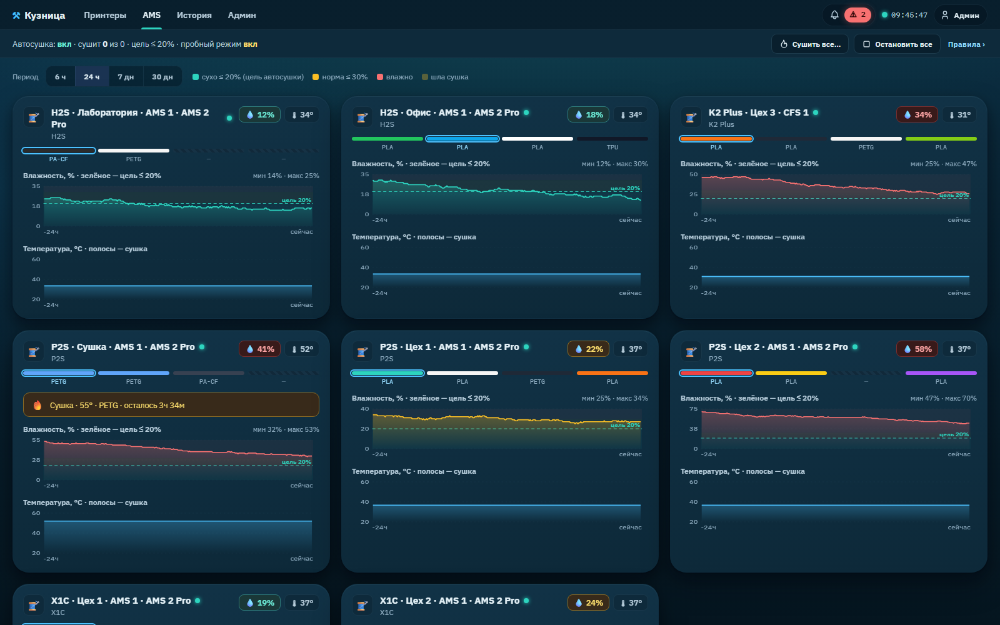

*AMS — humidity and temperature of every unit with drying periods, and the auto-drying line on
top.*

## Where to start

1. [Install](install/index.md) the dashboard — Docker, Windows or Linux / Raspberry Pi.
2. [First run](install/first-run.md) — read the administrator password and log in.
3. [Add your printers](printers.md).
4. Optionally set up [Telegram](telegram.md) and [HTTPS](security.md#https-with-nginx).
