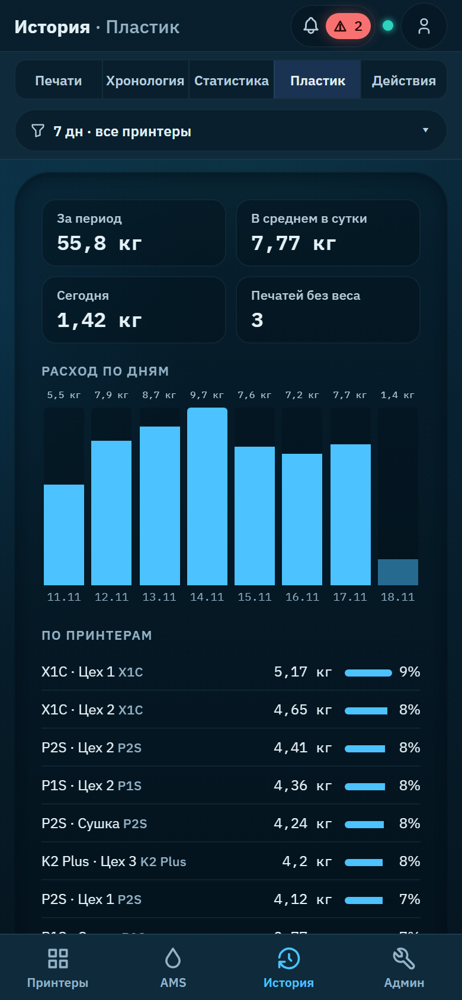
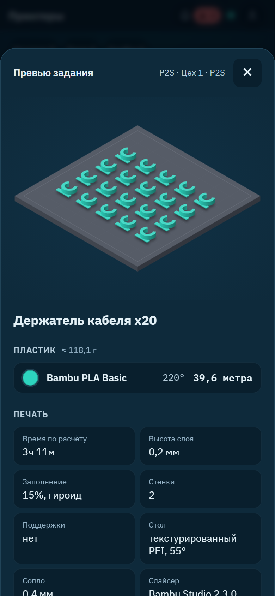

# Phone and app (PWA)

## The phone layout

On a screen narrower than 900 px the dashboard switches to a phone layout:

- **Bottom navigation** with the same screens — Printers, AMS, History, Admin (an icon above the
  word). Tapping the current tab again scrolls to the top.
- A thin **top line** with the screen's name (for example «История · Печати»), the bell and 👤.
- One column of cards.
- The farm's order and commands are in the **Farm ▾** («Ферма ▾») sheet.
- The finishes open as a list (**Finishes**, «Финиши») grouped into «Готовы · снять пластину»
  (ready — take the plate off), «Ближайшие N ч» (next N hours), «Позже» (later) and «Без оценки»
  (no estimate).
- Every pop-up opens as a **bottom sheet**; the phone's Back gesture closes it.
- AMS units are one-line rows; the admin tables (fleet, users, proxies) are shown as cards.
- On the Timeline: pinch to zoom, swipe to move, tap for details, double-tap to reset.

### The new screens on a phone

- **History → Prints** — three short lines per print: the printer, the start and the result; the
  job's name on its own line; the duration, the weight and the pauses. Tap a row for the details.
- **History → Filament** («Пластик») — the tiles two to a row. **By printer** becomes one block per
  printer without column headings, so on a phone (640 px and narrower) the **No weight** column is
  left out: the count stays in the «Печатей без веса» tile. On the narrowest screens the values
  over the day columns get smaller.
- **The job card** — on a screen up to 600 px wide it slides up from the bottom across the full
  width, with a shorter picture and the print settings in two columns. Tap a part on the plate map
  to pick it for skipping. The phone's Back gesture closes it.
- **Files on the printer** — the same full-width sheet; the filament → slot lists are narrower, and
  Back closes it (the ‹ in its head goes back to the file list).
- **Shared files by model** (*Admin → Fleet*) — the file table scrolls sideways; during a sync each
  printer is its name, its bar and the status under the bar.

 

*History → Filament and the job card on a phone.*

## Installing as an app (PWA)

The dashboard can be installed as an app: it then opens in its own window with the «Кузница» icon,
without the browser's address bar.

1. Open the dashboard in the browser through its **HTTPS** address. Browsers offer installation
   only on a secure address — see [HTTPS with nginx](../security.md#https-with-nginx).
2. Log in and open **👤 → This browser** («Этот браузер»). When the browser offers to install the
   dashboard, the **App** («Приложение») section appears there with the **Install** («Установить»)
   button. You can also use the install command in the browser's own menu.

What the app gives you:

- **Shortcuts** on the app icon: «Нужно решение» (needs a decision), «Финиши» (finishes) and «AMS».
- **Progress in the title**: «(N⚠) P% · Кузница» — how many printers need attention and the farm
  progress; the icon shows a progress ring.

The app is the same web page: it needs a connection to your dashboard server. Only static files
(styles, scripts, icons) are cached on the device — never printer data — and the cache is cleared
when you log out.
