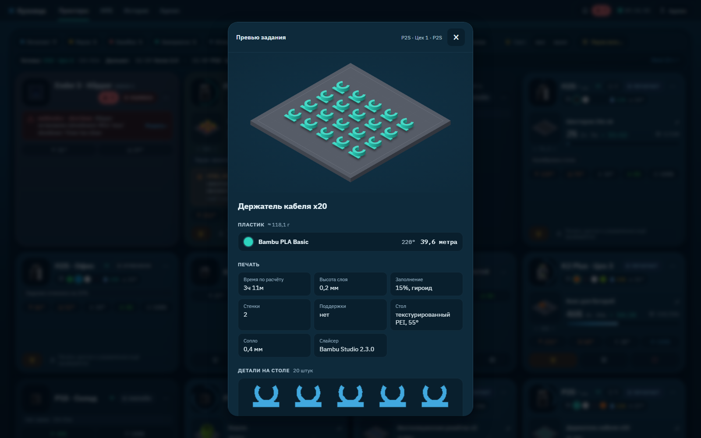
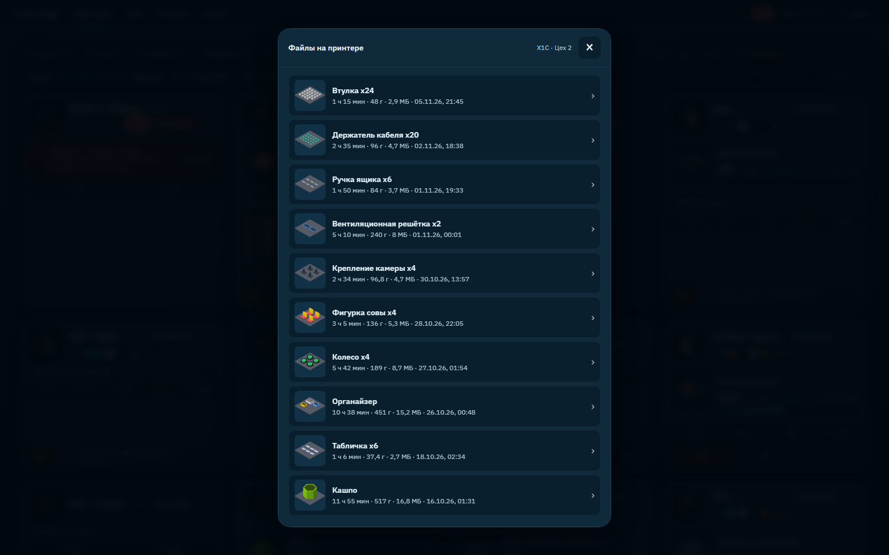

# Printers screen («Принтеры»)

The main screen: one card per printer and, above them, the farm row.

## The farm row

### State filters

The chips **Printing** («Печатает»), **Paused** («Пауза»), **Error** («Ошибка»), **Finished**
(«Завершено»), **Cancelled** («Отменено»), **Idle** («Простой»), **Offline** («Офлайн») and
**Maintenance** («Обслуживание», «Обсл.» on a phone) show how many printers are in each state.
They are also filters:

- click a chip — only those printers are shown;
- click it again — all printers;
- ++ctrl++ + click — add a state to the selection.

The choice is remembered in this browser.

### Order

**Order** («Порядок»): **Name** («Имя» — by name, P2 before P10) or **Finish** («Финиш» — finished
printers first, then printing printers by time left, the rest by name). A printer that needs a
decision is always first.

### Farm commands (administrators)

- **Light:** **on** / **off** («Свет: вкл / выкл») — on every online printer that has a controllable
  light.
- **Pause all…** («Пауза всех…») — opens a dialog where you tick which printing printers to pause,
  then **Pause selected (N)** («Пауза выбранных (N)»).
- **Resume N** («Продолжить N») — appears only when something is paused; you choose which to
  resume, then **Resume selected (N)** («Продолжить выбранные (N)»).

If some printers did not confirm, a line says so with a **Retry** («Повторить») button. Printers in
maintenance mode are skipped. On a phone these controls are in the **Farm ▾** («Ферма ▾») sheet.

### Finishes

Under the farm row: **Ready:** («Готовы:») — finished printers whose plate is waiting to be taken
off (or «нет — снимать нечего», "none — nothing to take off"), and **Next:** («Дальше:») — the next
finish times. The **Window 12 h ▾** («Окно 12 ч ▾») button unfolds a timeline of upcoming finishes
with a **Horizon** («Горизонт») of **12 h** or **24 h**.

Printers in maintenance and printers offline for a day or more are folded into **Not working · N**
(«Не в работе · N»).

## A printer card

A card shows the name and model with the model's picture (the official one for each Bambu and
Creality model; with an AMS or a CFS fitted, the combo photo), the state, progress, time left, the
current job, temperature chips (nozzle, bed, chamber), AMS or CFS slots and humidity, speed and
fans where the printer reports them, and the Wi-Fi signal as an icon (dBm in its tip).

### The job's picture and weight {#job-picture}

While a Bambu or Creality printer prints, the slicer's picture of the plate stands on the left of
the progress, with the job's weight under it, for example «≈ 128 г». Beside the picture are the
part's name, the stat row and the progress bar. Click the picture or the name to open the
[job card](#job-card).

The weight is the slicer's estimate for the **whole job** (its tip says «Расчётный расход на всё
задание», "estimated filament for the whole job"), not what has been used so far. It is read from
the job's own file — see [where the job card comes from](#where-the-job-card-comes-from). The
Ender-5 Max reports only the filament's length, so its weight is worked out from the length (see
[Adding printers → Ender-5 Max](../printers.md#ender-5-max)).

A job without a picture keeps the older layout: the job's name under the progress, the weight
beside it when it is known. Klipper and MKS printers have neither a picture nor a weight.

### Temperature charts

Click a temperature chip to see a chart of nozzle, bed or chamber temperature for **6ч / 24ч / 7д**
(6 h / 24 h / 7 days): the current temperature, the target as a dashed line and min / average /
max. For administrators the same pop-up has the setter on top: preset buttons (nozzle: PLA 220,
PETG 250, ABS 260, Off («Выкл»); bed: 60 / 80 / 100 / Off; chamber: 40 / 50 / 60 / 65 / Off — only
on printers with an actively heated chamber: the Bambu H2 series and a Creality K2 Plus / K2 Pro
that reports a chamber target) and **OK**.

Administrators also have:

- **Speed** chip — **Print speed** («Скорость печати»): Silent · 50 % («Тихий»), Standard · 100 %
  («Стандарт»), Sport · 124 % («Спорт»), Ludicrous · 166 % («Безумный»). On Creality only while
  printing.
- **Fans** — **Fans, %** («Вентиляторы, %»): sliders Part («Деталь»), Auxiliary («Вспом.»), Chamber
  («Камера») and **Apply** («Применить»). The Ender-5 Max has no auxiliary fan, and its part and
  case fans are only on or off, so it gets On / Off lists instead of sliders.
- **Air duct** («Воздуховод», P2S and H2 series) — under the fans, see [Air duct mode](#air-duct).
- **AMS** chip on Bambu — choose a slot and **Load** («Загрузить»), **Unload** («Выгрузить»),
  **Dry…** («Сушить…») or **Stop drying** («Остановить сушку»). Load and unload work only on an
  idle printer and ask for confirmation, explaining what the printer will do. Each unit also has
  **Spools: tag, material…** («Катушки: метка, материал…», see [Spools](#spools)) and, when the
  printer reports them, **⚙ AMS settings** («⚙ Настройки AMS»). A printer without AMS shows
  «внешняя катушка» (external spool) with **Unload filament** («Выгрузить филамент»).
- **CFS** chip on Creality — see [Creality CFS](#creality-cfs).

Viewers see the same chips, with charts only (the AMS and CFS chips show the slots without
buttons).

### Air duct mode (P2S, H2 series) {#air-duct}

Printers that report a switchable air duct get an **Air duct** («Воздуховод») row at the bottom of
the fans pop-up:

- **Cooling** («Охлаждение») — the chamber air is blown outside («Воздух камеры выводится наружу»);
- **Heating** («Обогрев») — the air stays in the chamber and goes through the filter («Воздух
  остаётся в камере и идёт через фильтр»).

The mode is sent at once — no **Apply** — and the current one is highlighted. Other printers do not
show the row, and the server refuses the command for them.

### Spools («Катушки») {#spools}

**Spools: tag, material…** («Катушки: метка, материал…») in the AMS pop-up opens the list of a
unit's slots. For each slot:

- **Tag** («Метка») — the AMS turns the spool and reads its RFID tag again. Only while the printer
  stands: not during a print or a pause, not during a filament change.
- **Edit…** («Изменить…») — set the slot's spool by hand: a material chip (PLA, PLA-CF, PETG,
  PETG-CF, PCTG, ABS, ASA, TPU, PA, PA-CF, PC, PVA, HIPS), the colour and the nozzle range
  («Сопло от» / «Сопло до», 150–350 °C; the material's usual range is filled in), then **Save**
  («Записать»). The printer gets Bambu's «Generic» profile of that material; the next tag read
  overwrites it. Allowed any time except on the slot that feeds the running print.

**⚙ AMS settings** («⚙ Настройки AMS») shows the switches the printer reports: **Backup spool**
(«Запасная катушка» — keep printing from another spool of the same material and colour when the
current one runs out) and **Remaining estimate** («Оценка остатка» — an estimate for Bambu-tagged
spools). Administrators switch them; otherwise they are read-only.

### Creality CFS {#creality-cfs}

A Creality with a CFS shows a CFS chip laid out like the AMS one; on the AMS screen each CFS unit
gets humidity and temperature charts like an AMS unit (drying is not available for it).
Administrators open its pop-up:

- per CFS unit its humidity and temperature, and the slots with the material and the remaining
  percent; the external spool is listed when it is the one in use;
- a slot button loads that slot, the loaded one unloads it;
- **Spools: tag, material…** («Катушки: метка, материал…») — **Tag** («Метка») re-reads the slot's
  tag; the material field and the colour, then **Save** («Записать»), set the slot by hand;
- **⚙ CFS settings** («⚙ Настройки CFS») — **Backup spool** («Запасная катушка»), when the printer
  reports it.

Load, unload and the tag read ask on the button first («Загрузить слот 2?» — press again). The slot
commands work only while the printer is idle, finished or cancelled; otherwise the pop-up says
«Только в простое — принтер печатает или занят» ("only when idle — the printer is printing or
busy").

### The control row (administrators)

Online printers have a row of buttons under the card. A button appears only if this printer can do
it (see [Adding printers](../printers.md) for each brand), and the row follows the printer's state,
so it never shows a button that is always grey in that state:

- **printing** — light, pause, stop;
- **paused** — light, resume, stop, cool down;
- **standing** (idle, finished, cancelled, error) — light, cool down, bed down, move.

| Button (tip) | What it does | Asks first? |
| --- | --- | --- |
| 💡 Light («Свет горит — выключить» / «Свет выключен — включить») | Toggles the light | no |
| ⏸ Pause («Пауза») / ▶ Resume («Продолжить печать») | Pauses or resumes the print | no |
| ⏹ Stop («Остановить печать») | Stops the print | yes — «Остановить печать?» → **Стоп** |
| ❄ Cool down («Остудить всё: сопло и стол», plus chamber where it can be set) | Sets heaters to 0 | only when paused — «На паузе — остудить?» |
| ⤓ Bed down («Опустить стол на 3 см, чтобы снять деталь») | Lowers the bed 3 cm to remove the part | no |
| ✥ Move («Перемещение, «Домой», филамент») | Opens the [move pop-up](#motion): home, axis jog, filament push / retract | no |

A button that cannot be used right now is greyed out and its tip says why — for example «Во время
печати остудить нельзя — сначала пауза или стоп» ("cannot cool down while printing — pause or stop
first"). The server refuses commands that the printer's current state forbids.

A **🔒 lock** means the light works but print control does not; its tip gives the reason (for
Bambu, usually «прошивка блокирует (нет Developer Mode)» — see
[Adding printers](../printers.md#bambu-lab)). MKS printers have no control row.

### Move, home and filament {#motion}

The ✥ button of a standing printer (Bambu, Creality, Klipper) opens the **Move** («Перемещение»)
pop-up:

- **Step** («Шаг») — 1, 10 or 50 mm (10 mm by default);
- **Home** («Домой») — finds the zero of every axis;
- **X− / X+** (head left / right), **Y+ / Y−** (head back / forward), **Z+ / Z−** (bed away from /
  towards the nozzle) — one step per press;
- **Filament · nozzle 215°** («Филамент · сопло», with the nozzle's temperature now) — **E− retract**
  («E− втянуть») pulls the filament out of the nozzle by the step, **E+ push** («E+ подать») pushes
  it in.

The pop-up stays open between presses, and each answer shows in its line. The rules:

- Axes and filament move only while the printer stands — never during a print or a pause, and not
  during a filament change («Оси двигаются, только когда принтер стоит — не во время печати и не на
  паузе»).
- After power-on, press **Home** first. Klipper itself refuses to move an axis that is not homed.
- Filament moves need a hot nozzle, 170 °C or more («Сопло холодное — подача и втягивание только от
  170 °C, сначала нагрев»): heat the nozzle from its temperature chip first.
- Creality printers do not take filament moves from the panel; their E buttons are grey with
  «Creality: подача и втягивание только с экрана принтера» (use the printer's screen).

### The ⋯ menu

The **⋯** in the card's head has, for everyone, links to this printer's prints («Печати принтера ›»)
and timeline («Хронология принтера ›»). Administrators also get:

- maintenance mode (see [below](#maintenance-mode));
- **Files on the printer ›** («Файлы на принтере ›», Bambu and Creality, while online) — see
  [Files on the printer](#files-on-the-printer);
- **Service ›** («Сервис ›», only a Creality with Klipper's API, such as the K2 Plus) — see
  [Service](#k2-service);
- **Printer settings ›** («Параметры принтера ›») — opens the printer's form in *Admin → Fleet*.

## Maintenance mode {#maintenance-mode}

Use it when a printer is being repaired or serviced. Administrators switch it from the card's
**⋯** menu:

- **In maintenance…** («На обслуживании…») — optional note («что делаем», up to 200 characters),
  then **Set** («Поставить»).
- While in maintenance: **Maintenance note…** («Заметка обслуживания…») and **✓ End maintenance**
  («✓ Снять с обслуживания»), which asks for confirmation.

The card keeps showing the real state, with a line like «обслуживание · с 14:32 · <note>». The
printer is left out of the state counts, load, finishes, notifications (badge, bell, browser
pop-ups, Telegram), farm commands, AMS auto-drying and the automatic error skipping; on the
timeline its time shows as a hatched «обслуживание» segment. Commands from its own card still
work.

## Printer notifications {#printer-notifications}

Every Bambu HMS message and print error is listed on the printer's card; Creality shows its error
code, and Klipper the reason it stopped.

- **The badge** «⚠ N» in the colour of the worst level appears when a decision is needed or a
  critical error is less than 30 minutes old; otherwise a grey «ⓘ N». Click it for the list.
- **The strip** under the progress appears for a critical or pause error while the printer is
  paused or in error. It ends with **Resolve ›** («Решить ›») for an administrator or **Details ›**
  («Подробнее ›»).
- **Levels:** Critical («Критично»), Pause error («Пауза-ошибка»), Serious («Серьёзно»), Notice
  («Уведомление»), Info («Инфо»). Maintenance reminders are folded as «плановые» ("scheduled").
- **Action buttons** are the ones Bambu Studio shows for that code (taken from Bambu's own tables),
  for example «Продолжить печать», «Игнорировать и продолжить», «Остановить печать». Only
  administrators see them. Each action is checked against the live printer right before it is sent;
  dangerous ones ask first (e.g. «Остановить печать? Задание будет потеряно.»).
- **Hide** («Скрыть», administrators) — the notification stops counting in the badge, the bell, the
  tab title and browser pop-ups, for everyone. Hidden ones are kept under «скрытые · N» with
  **Restore** («Вернуть»). Nothing is sent to the printer.

**Creality errors.** A Creality error notification has the answer the printer's own web page
gives:

- **Clear the error** («Сбросить ошибку») — clears it on the printer. It neither resumes nor stops
  the print; fix the cause first.
- **Restart the firmware** («Перезапустить прошивку») — for the error codes the printer's page
  answers with a restart (1–6, 8 and 200). It asks first («Перезапустить прошивку принтера? Он
  перезагрузится, текущее задание будет потеряно.») and is refused while the printer prints or is
  paused.
- **Resume print** («Продолжить печать») — on a paused K2 Plus (through Klipper's API), the same as
  the card's ▶: the printer heats the nozzle back, purges about 80 mm of filament at the wipe spot,
  cleans the nozzle and carries on. Look at the part first. A pause by the camera's AI detection is
  named (code AC0101).

**The bell** in the top bar lists the printers that need a decision («Нужно решение») first and
the rest folded. At its foot administrators have **Clear errors (N)** («Сбросить ошибки (N)»): it
closes the "task cancelled" dialogs on printer screens and first shows which printers will
(«Попадут») and will not («Не попадут») be affected. Creality printers are not in it — use the
button in each one's notification.

## The job card {#job-card}

Click a job's picture or name — on a printer card or in
[History → Prints](history.md#prints) — to open the **job card** («Превью задания», "job preview").
It shows what the slicer prepared:

- the printer and its model, and the plate number of a Bambu job;
- the slicer's picture of the plate and the job's name;
- in the history, the slicer's **Planned time** («Плановое время»; a live job's time left is on its
  card);
- **Filament** («Пластик») with the total weight, then each filament: its colour, type and slicer
  profile, the nozzle temperature, grams (when there are several) and metres;
- **Print** («Печать») — the slicer's time, layer height (and the first layer's), infill and its
  pattern, walls, supports and their weight, the bed type and temperature, the nozzle diameter, the
  part size, planned pauses, print sequence by object, ironing, timelapse and the slicer with its
  version — each one only when the file has it;
- **Parts on the plate** («Детали на столе») — how many parts, the plate map, and the parts' names
  with ×N for copies and the ones skipped.

Values the file does not have are left out, never guessed.

### Where the job card comes from {#where-the-job-card-comes-from}

| Printer | What the dashboard reads | What the card gets |
| --- | --- | --- |
| Bambu X1, P2, H2, X2 | the running job's data from the printer's memory; the job's 3MF from the SD card or USB stick when it is there | from memory: the picture, filaments, weight, time, the parts and the plate map. The print settings (layer height, infill, walls, supports…) only when the job's file is also on the SD card or USB stick |
| Bambu P1, A1 | the job's 3MF from the SD card | everything the file has |
| Creality K1C and others | the printer's file list and its current-print picture | the picture, filaments (type, colour, grams), time, nozzle and bed temperatures, part size, slicer |
| Creality K2 Plus | the same, plus the job's G-code through Klipper's API | also layer height, infill, walls, supports and their weight, bed, filament profiles and the slicer's version |
| Creality Ender-5 Max | its older file list, which has the filament's length, and the current-print picture | the picture and the weight worked out from the length |
| Klipper, MKS | — | no job card |

The supports' weight is counted from the job's G-code (the slicer writes only the total), so it may
appear a few minutes after the rest. The card is kept with the print: it opens from
[History → Prints](history.md#prints) after the printer has moved on, and the nightly backup copies
it (`data/job_previews/`).

## Skipping parts mid-print {#skip-parts}

On a printing or paused Bambu or Creality printer, an administrator can skip single parts of the
plate — for example one that came loose — and let the rest finish.

1. Open the job card from the printer's card (not from the history: there the map is only a
   picture).
2. Click the parts to skip on the plate map — they turn red; hover a part to see its name. The line
   under the map counts them: «Выбрано: 2» (selected).
3. Press **Skip N parts** («Пропустить N детали»), then once more when it asks «Точно пропустить?
   Нажмите ещё раз» ("skip for sure? press again").

Parts already skipped are grey and counted («Пропущено: N»). You cannot skip every part — that is
**Stop** («Пропустить все детали нельзя — для этого есть «Стоп»»). The server checks the ids
against the running job again before sending.

- **Bambu:** the map is the slicer's plate picture with every part. The job must have been sliced
  with object labelling on; otherwise the card says «Маркировка деталей не включена в слайсере —
  пропуск недоступен».
- **Creality** (K2 Plus, K1C, Ender-5 Max): the printer reports the parts with their outlines in bed
  millimetres, drawn on the bed; the tip also marks the part printing now («печатается сейчас»).
  Parts without outlines are a list with tick boxes. The job needs at least two parts.

Viewers see the map without the button.

## Files on the printer {#files-on-the-printer}

**⋯ → Files on the printer ›** («Файлы на принтере ›», administrators, Bambu and Creality) lists the
print files stored on the printer, newest first: the picture, the name, the slicer's time, grams,
size and date. The list is read from the printer each time you open it («Получаю список файлов с
принтера…»); Bambu pictures fill in one by one.

Click a file to open it (**Print a file**, «Печать файла»):

- **Bambu:** a button per plate when the file has several; the plate's time, grams and nozzle size;
  **Filament → slot** («Пластик → слот») — a slot for each filament of the plate, picked for you
  (a loaded slot of the same material with the nearest colour, else the external spool) and
  changeable; **Bed leveling** («Калибровка стола», on) and **Timelapse** («Таймлапс», off).
- **Creality:** the file's time, grams, size and date and its filaments. A K2 picks the CFS slots
  itself, as when the print is started from its screen.

**Print** («Печать») asks on the button first — «Стол чистый? Нажмите ещё раз — печать начнётся»
("is the bed clear? press again — the print starts") — and the second press starts. The answer is
«Принтер принял задание» (the printer accepted the job) or «Задание отправлено, ждём принтер» (sent,
waiting for the printer). Every start is written to [History → Actions](history.md#actions-administrators).

A start is refused when:

- the printer is not free — printing, paused, preparing or changing filament (start it when it is
  idle, finished or cancelled);
- the file is not in a list read in the last 5 minutes («Этого файла нет в свежем списке — откройте
  список файлов заново»);
- a Bambu printer does not accept print commands (no Developer Mode, see
  [Adding printers](../printers.md#bambu-lab));
- the printer has two nozzles (H2D, H2C, X2D) — not supported yet;
- the printer does not give out the file's contents, so its plates cannot be read — then start it
  from the printer's screen («Принтер не отдаёт содержимое этого файла…»).

What each printer lists:

| Printer | Files listed | Can be started from the panel |
| --- | --- | --- |
| Bambu X1 | the printer's storage (SD card) | yes |
| Bambu P1, A1 | SD card | yes |
| Bambu P2S and the other H2 / X2 models | internal storage and a USB stick | files on the USB stick; files in the internal storage only from the printer's screen |
| Bambu H2S | a USB stick only: its internal storage stays closed to the network, and with no stick the dialog says so («Принтер не открывает свою память по сети…») | files on the USB stick |
| Creality | the printer's file list | yes |
| Creality K2 Plus | through Klipper's API, with the file list's pictures, times and grams | yes; also **Delete from the printer** («Удалить с принтера», asks on the button, only while the printer is free) |

If a P2S or H2 printer's USB stick cannot be read, the internal files are still listed with a note
above the list. Factory sample models (3DBenchy, Vase and the like) are hidden by default; with
[Hide factory samples](admin.md#general) off they are listed last, marked «образец» (sample).

To put the same files on every printer of a model, use
[Shared files by model](shared-files.md).

## Service (K2 Plus) {#k2-service}

**⋯ → Service ›** («Сервис ›», administrators) appears on a Creality that answers on Klipper's API
(Moonraker, port 7125), such as the K2 Plus. Each button runs the printer's own macro:

| Button | What the printer does |
| --- | --- |
| **Bed leveling** («Калибровка стола») | auto levelling: heats the bed and nozzle, wipes the nozzle on the bed, measures the bed mesh — 10–20 min |
| **Nozzle PID** («PID сопла») | heats the nozzle with the fan on; at the end Klipper saves the result and restarts |
| **Bed PID** («PID стола») | heats the bed; at the end Klipper saves the result and restarts |
| **Input shaper calibration** («Калибровка резонансов») | head to the centre, X and Y vibrations measured and saved |
| **Belt tension** («Натяжение ремней») | motors switch off, the tensioners set both belts |
| **Firmware restart** («Перезапуск прошивки») | Klipper and the printer's boards restart, about a minute |

Each button asks on itself first («Запустить «…»? Нажмите ещё раз»). Service runs only while the
printer is free — not printing, not paused, no error — and one at a time; the printer's last console
lines show while it runs. Manual bed calibration, Z axis calibration, the calibration print and the
cutter calibration are not here: they run from the printer's screen.

## Lamp on when a printer stops {#lamp-on-stop}

When a printer steps into **paused**, **error** or **cancelled**, the dashboard switches its chamber
lamp on, so the cameras show what happened. It does so once per stop and only if the lamp is off:
if you switch it off again, it stays off until the next stop. A pause that
[auto-skip](admin.md#auto-skip-errors) is about to wave through does not light the lamp, unless
auto-skip gives up on it. Each switch-on is logged in History → Actions, group Automation
(«Автоматика»). Printers without a controllable light are left alone. Which states light the lamp
can be changed without a page — see [Settings](../configuration.md#settings-without-a-page).

## The tab title

The browser tab shows the farm at a glance: «(N⚠) P% · Кузница», and «нет связи · Кузница» when the
server has not answered for 30 seconds. The tab icon shows a progress ring.
