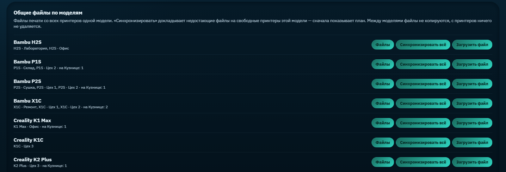

# Shared files by model («Общие файлы по моделям»)

Keep the same print files on every printer of one model: upload a file to the dashboard once, or
take it from one printer, and send it to all the others of that model with one button.

It is in **Admin → Fleet** («Админ → Парк»), under the printer table, so only administrators see
it.

## Groups

Every Bambu and Creality model of the fleet is a group, titled like the printer's card — for
example «Bambu P1S» or «Creality K2 Plus» — with its printers and how many files were uploaded to
the dashboard («на Кузнице: N»). Models are never mixed: a file goes only to printers of the same
model. Klipper and MKS printers have no group.

Each group has the buttons:

- **Files** («Файлы») — unfolds the group's files. The dashboard asks each printer of the model for
  its list («Собираю списки файлов с принтеров…») and adds its own uploads. The same name and size
  is the same file.
- **Sync everything** («Синхронизировать всё») — or, with files ticked in the list, **Sync the
  picked: N** («Синхронизировать выбранные: N»). Shows the plan first.
- **Upload a file** («Загрузить файл») — uploads a file from your computer to the dashboard:
  a sliced `.gcode.3mf` for Bambu, a `.gcode` for Creality.

## The file list

| Column | What it shows |
| --- | --- |
| tick box | pick the file for **Sync the picked**; only files that can be copied have it |
| **File** («Файл») | the name; «на Кузнице» (on Kuznitsa) for a file uploaded to the dashboard, «образец» (sample) for a factory sample, «не копируется» (not copyable) with the reason for a file nobody can give out |
| **Size** («Размер») | |
| **Where it is** («Где лежит») | a chip per printer of the model, lit where the file is |
| × | **Remove from Kuznitsa's storage** («Убрать из хранилища Кузницы») — for an uploaded file; it is removed from the dashboard only, never from the printers |

Printers that sent no list are named above it («Без списка: …» with the reason, for example «не на
связи», offline).

## Syncing

1. Press **Sync everything** (or **Sync the picked**). The dashboard works out the plan («Считаю
   план…»).
2. The plan says **Plan: N copies, size** («План: N копий, …») and, per printer, how many files and
   bytes it will get (**which** — «какие» — unfolds the names). It also lists:
    - files it will **leave alone** because the printer already has a different file of the same
      name («Не тронем (там другой файл с тем же именем)»);
    - printers **skipped** and why («Пропущены:» — offline, busy printing or preparing, no USB stick,
      no SD card…);
    - files it **cannot copy** because no printer gives them out («Не скопировать»).
3. Press **Copy** («Копировать»), then press it again when it asks «Нажмите ещё раз — начнём
   копировать». **Cancel** («Отмена») drops the plan.
4. The copy runs with a bar per printer: waiting («ждёт»), copying («копирую»), done («готово»),
   error («ошибка») or skipped («пропущен»), with the files done and the file being copied. Only
   one sync runs at a time; it carries on if you leave the page.

The rules:

- **Nothing is deleted or overwritten on a printer.** Files are only added; a different file of the
  same name is left alone and listed.
- **Never across models.**
- Before each file the printer is checked again: online and not printing or preparing.
- The printers do not report free space — make sure there is room.
- Factory samples are never copied.

## What each printer allows

| Printer | Gives its files out (a source) | Takes files (a target) |
| --- | --- | --- |
| Bambu X1, P1, A1 | every file | to the SD card — needs an SD card in the printer |
| Bambu P2S, H2 series, X2D | only files on a USB stick | to a USB stick only — needs a stick in the printer; the internal storage takes no files over the network |
| Creality K2 Plus | every file (through Klipper's API) | yes |
| Other Creality (K1C, Ender-5 Max…) | none — upload the file to the dashboard instead | yes, through the printer's own web page |

A file that exists only in a P2S or H2 printer's internal storage is shown as not copyable («лежит
только во внутренней памяти — прошивка её не отдаёт; нужна копия на флешке или в панели»): put a copy
on a USB stick or upload it to the dashboard.

## Storage limits

Uploaded files are kept in `data/file_pool/` on the dashboard's computer. Out of the box one file
may be up to 512 MB, all uploads together up to 8 GB, and an upload stops while the disk has less
than 1 GB free. A file of the same name as one already uploaded is refused. The limits are set by
`FORGE_FILE_POOL_MAX_GB`, `FORGE_FILE_POOL_FILE_MAX_MB` and `FORGE_FILE_POOL_KEEP_FREE_MB` — see
[Settings](../configuration.md#file-pool).

Uploads, syncs and removals are written to [History → Actions](history.md#actions-administrators).

## Factory samples

The demo models printers ship with (3DBenchy, Vase and the like) are hidden from the list and never
synced while **Hide factory samples** («Скрывать заводские образцы») is on, which it is by default —
see [Admin → System](admin.md#general). With it off they are listed, marked «образец», but still
never copied.
