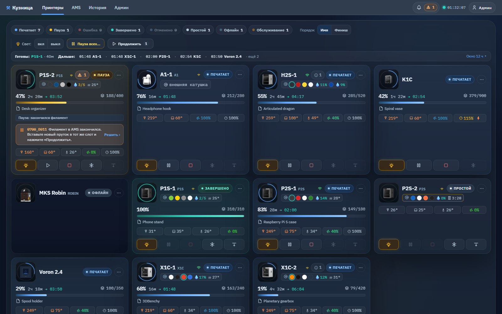
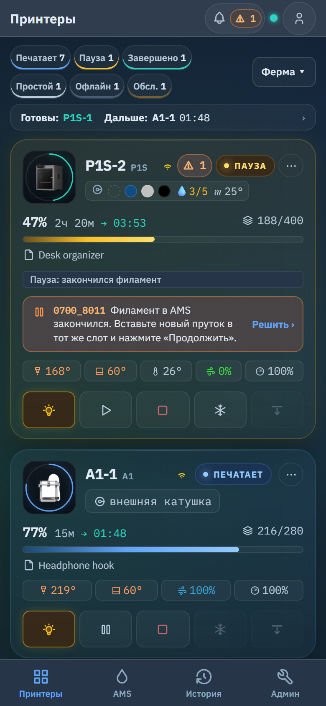
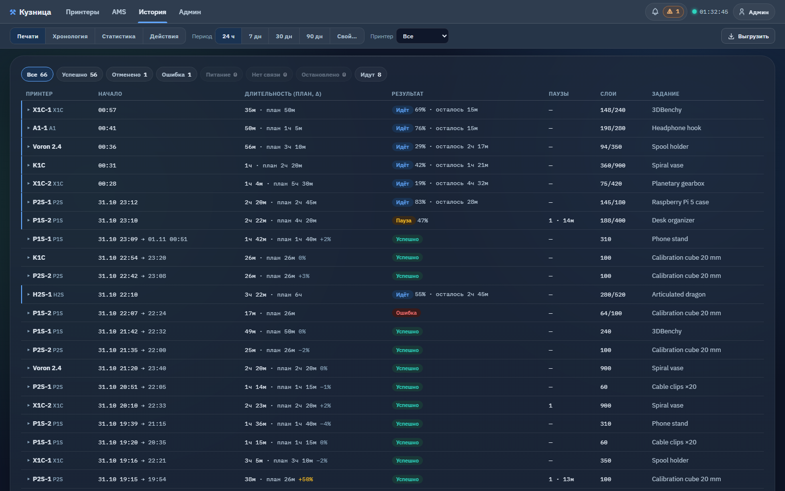
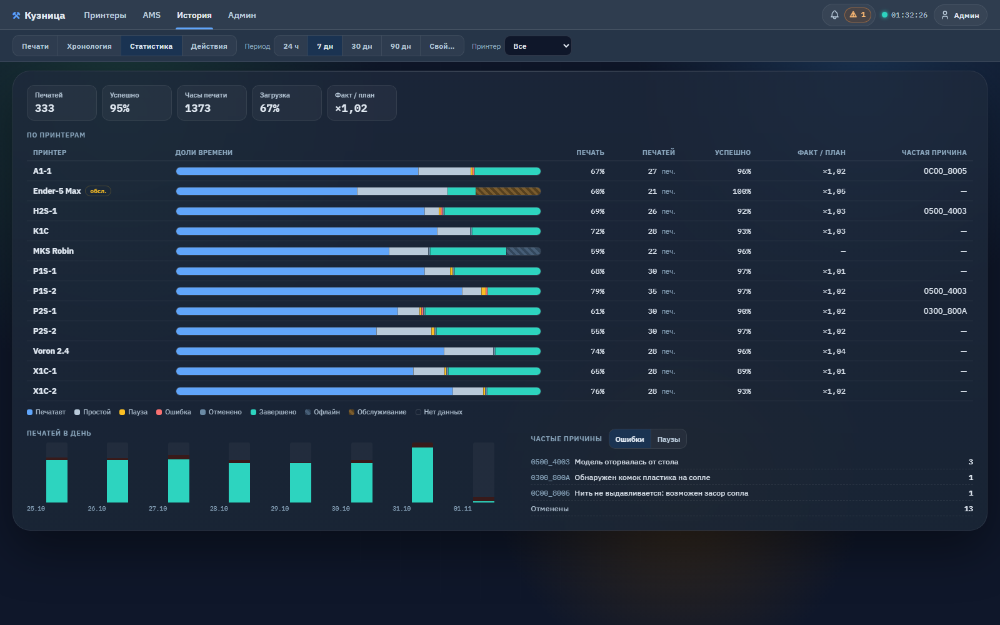
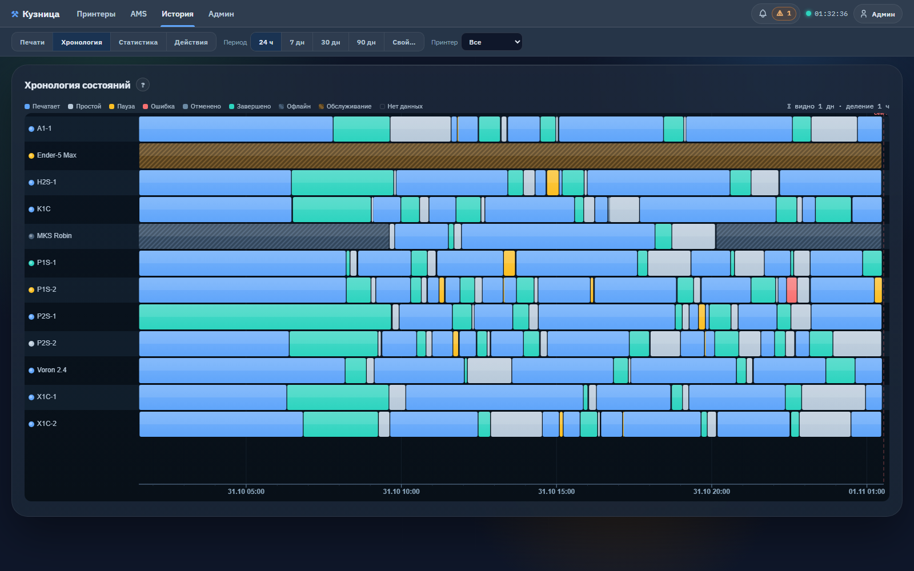
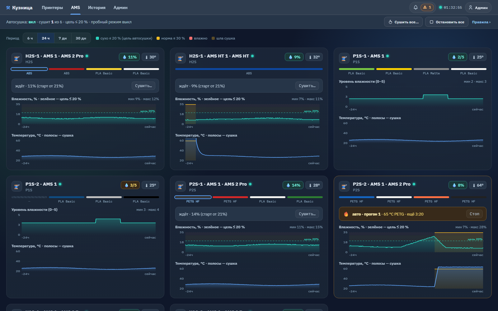

# Кузница

**Кузница** (Kuznitsa) — панель для фермы 3D-принтеров, которую вы запускаете на своём компьютере.
На одной веб-странице видны все принтеры фермы, даже разных марок: состояние, прогресс, температуры,
AMS, уведомления и история. Администратор может управлять принтерами удалённо.

- Работает внутри вашей локальной сети: панель обращается к каждому принтеру напрямую. Облачная
  учётная запись не используется.
- Бесплатна и открыта (AGPL-3.0); есть и коммерческая лицензия — см. [Лицензия](license.md).
- Документация описывает **версию 2.0.0** (вышла 1 ноября 2026 г.).

## Какие принтеры поддерживаются

| Марка | Модели в форме «Добавить принтер» | Как панель подключается |
| --- | --- | --- |
| **Bambu Lab** | X1, X1 Carbon, X1E, P1P, P1S, P2S, A1, A1 mini, H2D, H2S | MQTT поверх TLS, порт 8883 (пробуется и 8884) |
| **Creality** | K1 Max, K1C, Ender-5 Max | WebSocket, порт 9999 |
| **Klipper / Moonraker** | любые — модель вводится текстом | WebSocket Moonraker, по умолчанию порт 7125 |
| **MKS WiFi** | любые — модель вводится текстом | G-код по TCP, по умолчанию порт 8080 |

В README поддержка Creality описана как «K1 series / Sonic Pad». Что нужно для каждой марки и где
это взять — на странице [Добавление принтеров](printers.md).

## Что умеет

- **Одна живая доска** — все принтеры на одной странице: состояние, прогресс, сколько осталось,
  температуры сопла / стола / камеры, текущее задание, сигнал Wi-Fi, AMS. Карточки обновляются
  каждые 2 секунды.
- **Четыре экрана** — «Принтеры», «AMS», «История», «Админ». Зритель видит три (без «Админ»). На
  телефоне — нижняя панель навигации; панель можно установить как приложение (PWA).
- **Уведомления принтеров с действиями** — каждое сообщение HMS и ошибка печати Bambu видны на
  карточке принтера, с теми же кнопками, что показывает Bambu Studio.
- **История** — журнал печатей (строка на каждую печать), хронология состояний, статистика и, для
  администраторов, журнал всех действий.
- **Режим обслуживания** — вывести принтер из подсчётов, уведомлений и автоматики фермы, не теряя
  его живого состояния.
- **Графики температур** — сопло, стол и камера за 6 ч / 24 ч / 7 дней.
- **Уведомления в Telegram** (по желанию, по умолчанию выключены) — о завершении, паузе или ошибке,
  при необходимости через прокси.
- **Удалённое управление** для администратора — свет, пауза / продолжение, стоп, охлаждение,
  опустить стол, температуры, вентиляторы, скорость; на Bambu — загрузка / выгрузка филамента в AMS
  и сушка. Кнопка появляется, только если принтер это поддерживает.
- **Автосушка AMS** — сушит AMS 2 Pro / AMS HT, когда влажность долго остаётся высокой. Из коробки
  включена в пробном режиме: только пишет журнал.
- **Пользователи и роли** — «Админ» и «Зритель», защита входа и журнал действий.
- **Парк принтеров настраивается на веб-странице** — добавлять, менять и удалять принтеры можно
  без правки файлов.

## Скриншоты

На всех скриншотах — синтетическая демо-ферма, без настоящих принтеров и заданий.

*«Принтеры» — все принтеры на одной странице: состояние, прогресс, сколько осталось, температуры,
слоты и влажность AMS, уведомление, которое требует решения, чипы состояний, ближайшие финиши и
строка управления администратора.*

*На телефоне — одна колонка, нижняя навигация, всплывающие окна выезжают снизу.*

*«История → Печати» — строка на каждую печать: старт, длительность против плана слайсера, результат,
паузы, слои.*

*«История → Статистика» — печати, доля успешных, часы печати, загрузка, доли состояний по
принтерам, печатей в день, частые ошибки.*

*«История → Хронология» — состояние каждого принтера за выбранный период.*

*«AMS» — влажность и температура каждого блока с периодами сушки и строка автосушки сверху.*

## С чего начать

1. [Установите](install/index.md) панель — Docker, Windows или Linux / Raspberry Pi.
2. [Первый запуск](install/first-run.md) — узнайте пароль администратора и войдите.
3. [Добавьте принтеры](printers.md).
4. По желанию настройте [Telegram](telegram.md) и [HTTPS](security.md#https-nginx).
