# Кузница

**Кузница** (Kuznitsa) — панель для фермы 3D-принтеров, которую вы запускаете на своём компьютере.
На одной веб-странице видны все принтеры фермы, даже разных марок: состояние, прогресс, температуры,
AMS, уведомления и история. Администратор может управлять принтерами удалённо.

- Работает внутри вашей локальной сети: панель обращается к каждому принтеру напрямую. Облачная
  учётная запись не используется.
- Бесплатна и открыта (AGPL-3.0); есть и коммерческая лицензия — см. [Лицензия](license.md).
- Документация описывает **версию 2.2.0** (вышла 18 ноября 2026 г.).
- Интерфейс — на русском или английском (переключается в 👤 → «Этот браузер»).

## Какие принтеры поддерживаются

| Марка | Модели в форме «Добавить принтер» | Как панель подключается |
| --- | --- | --- |
| **Bambu Lab** | X1, X1 Carbon, X1E, P1P, P1S, P2S, A1, A1 mini, A2L, H2C, H2D, H2D Pro, H2S, X2D | MQTT поверх TLS, порт 8883 (пробуется и 8884) |
| **Creality** | K1 / K2, Ender-3 V3 / V3 KE / V3 Plus, Ender-5 Max, CR-10 SE, Hi, SPARKX i7 и совместимые модели | WebSocket, порт 9999; если принтер отвечает и через Klipper API (Moonraker, порт 7125), как K2 Plus, — то и через него; это находится само |
| **Klipper / Moonraker** | любые — модель вводится текстом | WebSocket Moonraker, по умолчанию порт 7125 |
| **MKS WiFi** | любые — модель вводится текстом | G-код по TCP, по умолчанию порт 8080 |

Что нужно для каждой марки и где это взять — на странице [Добавление принтеров](printers.md).

## Что умеет

- **Одна живая доска** — все принтеры на одной странице: состояние, прогресс, сколько осталось,
  температуры сопла / стола / камеры, текущее задание с картинкой из слайсера и весом, сигнал Wi-Fi,
  AMS или CFS. Карточки обновляются каждые 3 секунды.
- **Четыре экрана** — «Принтеры», «AMS», «История», «Админ». Зритель видит три (без «Админ»). На
  телефоне — нижняя панель навигации; панель можно установить как приложение (PWA).
- **Карточка каждой печати** — картинка стола из слайсера, каждый пластик с цветом, типом, граммами
  и метрами, настройки печати и детали на столе; хранится в истории. Со схемы стола администратор
  может пропустить отдельные детали прямо во время печати (Bambu и Creality).
- **Файлы на принтере** — список файлов печати на принтере Bambu или Creality и запуск печати из
  панели; **общие файлы по моделям** одной кнопкой раскладывают одни и те же файлы на все принтеры
  модели.
- **Уведомления принтеров с действиями** — каждое сообщение HMS и ошибка печати Bambu видны на
  карточке принтера, с теми же кнопками, что показывает Bambu Studio; ошибку Creality можно сбросить
  или перезапустить прошивку из панели.
- **История** — журнал печатей (строка на каждую печать), хронология состояний, статистика, расход
  пластика по дням и принтерам и, для администраторов, журнал всех действий.
- **Режим обслуживания** — вывести принтер из подсчётов, уведомлений и автоматики фермы, не теряя
  его живого состояния.
- **Графики температур** — сопло, стол и камера за 6 ч / 24 ч / 7 дней.
- **Уведомления в Telegram** (по желанию, по умолчанию выключены) — о завершении, паузе или ошибке,
  при необходимости через прокси.
- **Удалённое управление** для администратора — свет, пауза / продолжение, стоп, охлаждение,
  опустить стол, температуры, вентиляторы, скорость; «Домой», сдвиг осей, подача / втягивание
  прутка; на Bambu — загрузка / выгрузка филамента в AMS, сушка и катушки, режим воздуховода на
  P2S / H2; слоты CFS на Creality. Кнопка появляется, только если принтер это поддерживает. Когда
  принтер останавливается, свет включается сам.
- **Автосушка AMS** — сушит AMS 2 Pro / AMS HT, когда влажность долго остаётся высокой. Из коробки
  включена в пробном режиме: только пишет журнал.
- **Пользователи и роли** — «Админ» и «Зритель», защита входа и журнал действий.
- **Парк принтеров настраивается на веб-странице** — добавлять, менять и удалять принтеры можно
  без правки файлов.

## Скриншоты

На всех скриншотах — синтетическая демо-ферма, без настоящих принтеров и заданий.

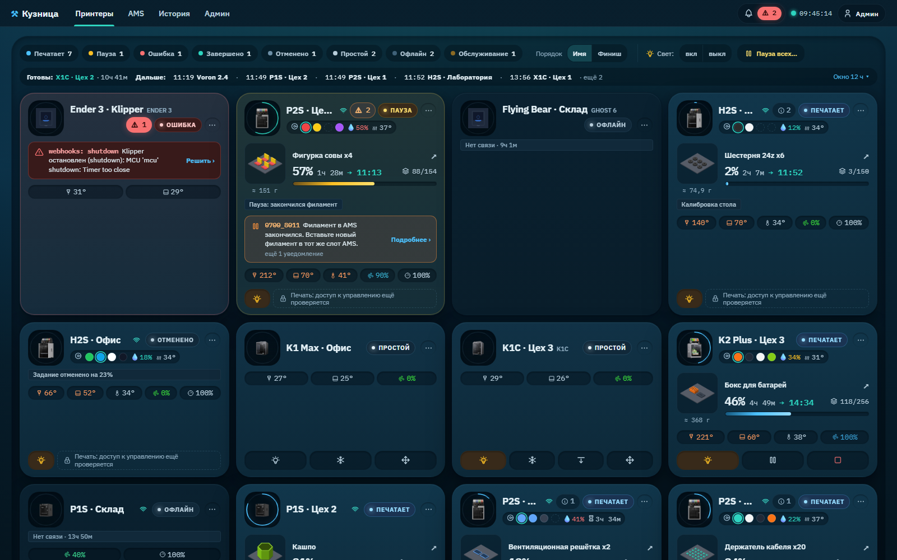

*«Принтеры» — все принтеры на одной странице: состояние, прогресс, картинка и вес задания, сколько
осталось, температуры, слоты и влажность AMS, уведомление, которое требует решения, чипы состояний,
ближайшие финиши и строка управления администратора.*

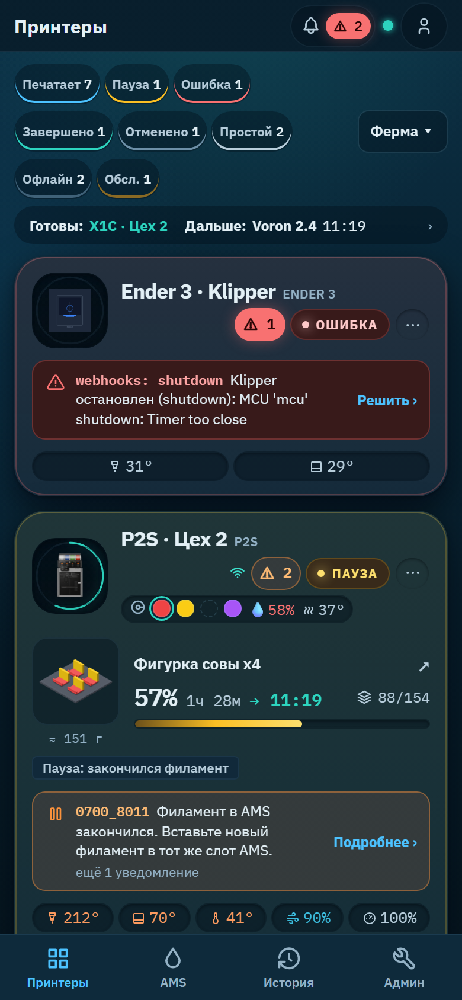

*На телефоне — одна колонка, нижняя навигация, всплывающие окна выезжают снизу.*

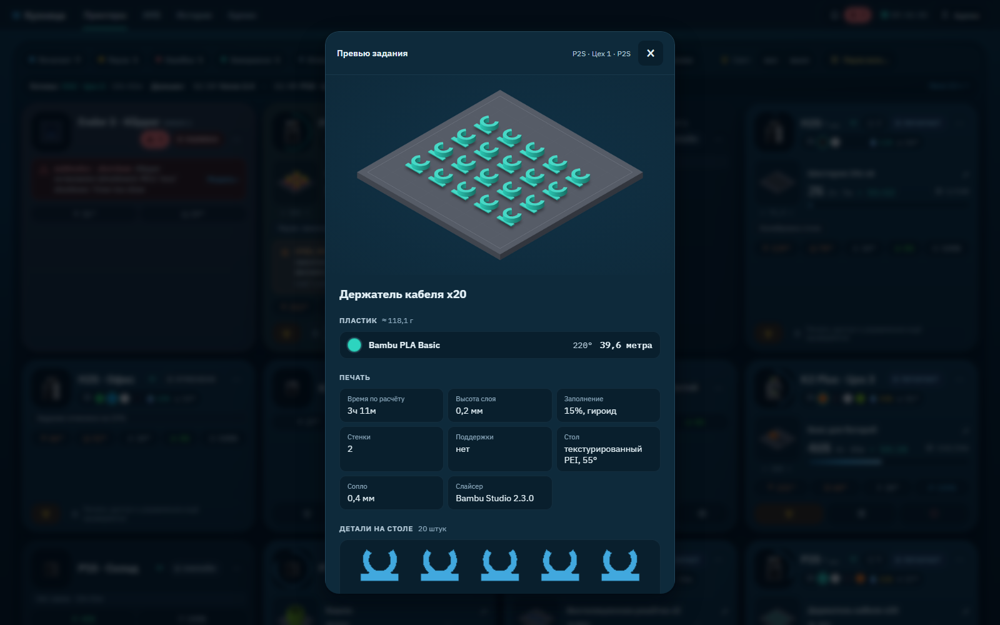

*Карточка задания («Превью задания») — картинка стола из слайсера, каждый пластик с весом,
настройки печати и детали на столе, где администратор может пропустить деталь во время печати.*

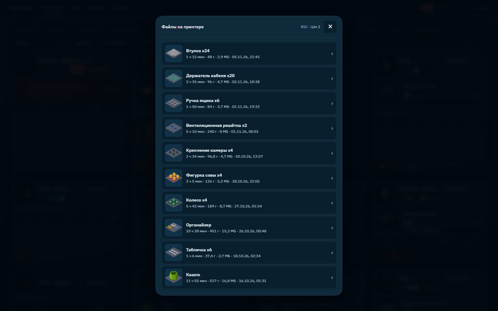

*«Файлы на принтере» — файлы, которые лежат на принтере, и открытый файл: выбрать стол и слоты AMS
и запустить.*

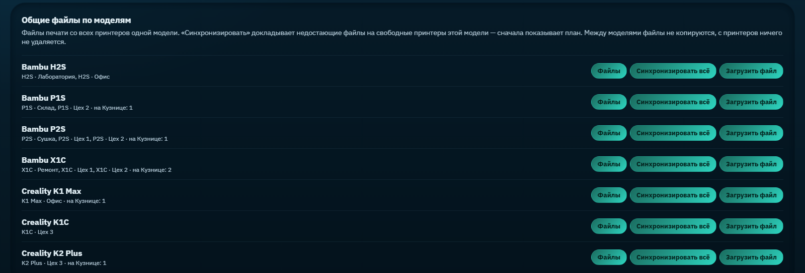

*«Общие файлы по моделям» — все файлы принтеров одной модели, у кого какой есть, и план перед
копированием недостающих.*

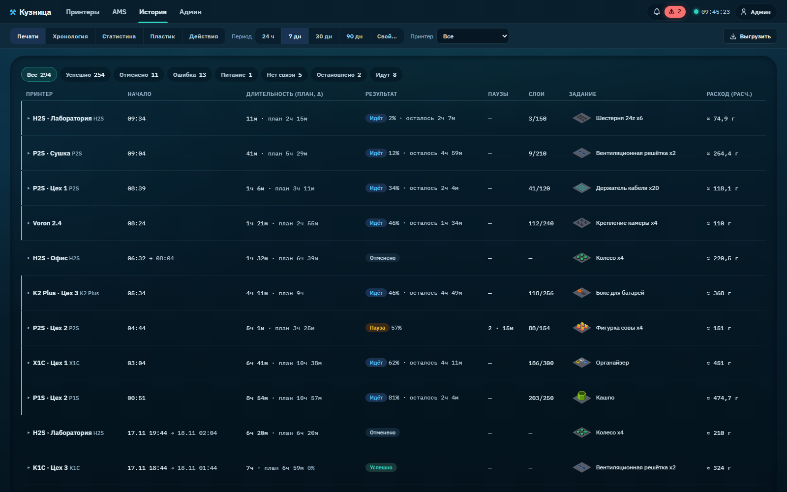

*«История → Печати» — строка на каждую печать: старт, длительность против плана слайсера, результат,
паузы, слои.*

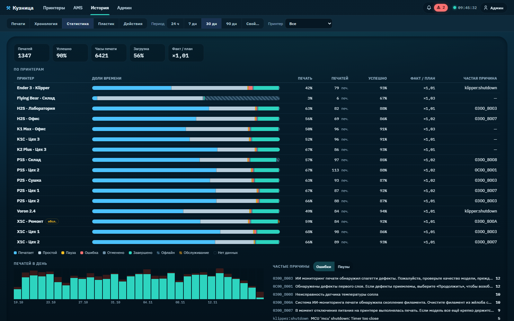

*«История → Статистика» — печати, доля успешных, часы печати, загрузка, доли состояний по
принтерам, печатей в день, частые ошибки.*

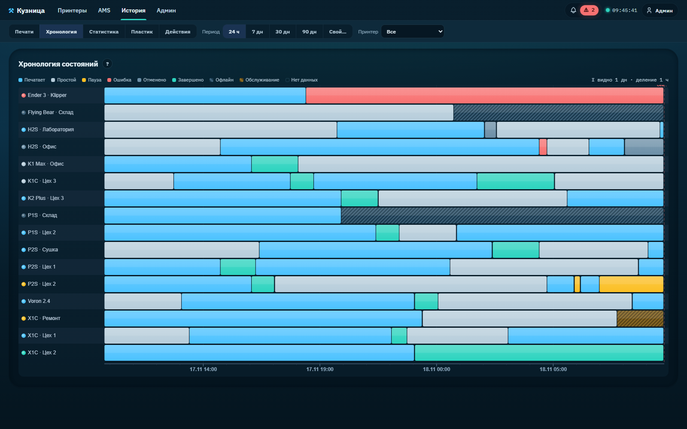

*«История → Хронология» — состояние каждого принтера за выбранный период.*

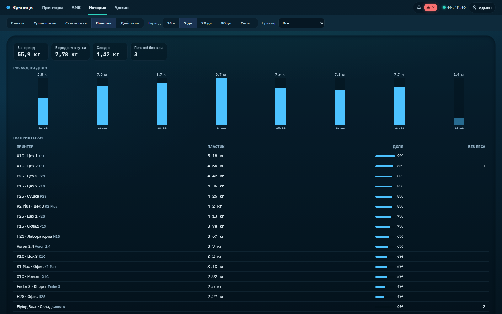

*«История → Пластик» — сколько пластика ушло за период, по дням и по принтерам, по весу каждой
печати из слайсера.*

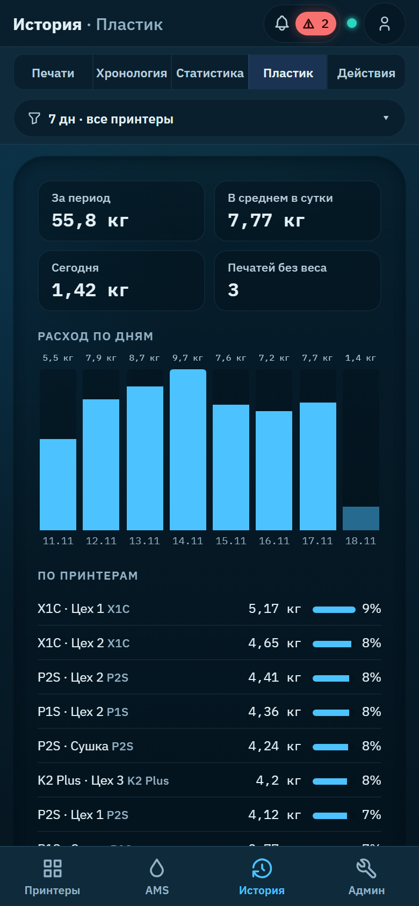 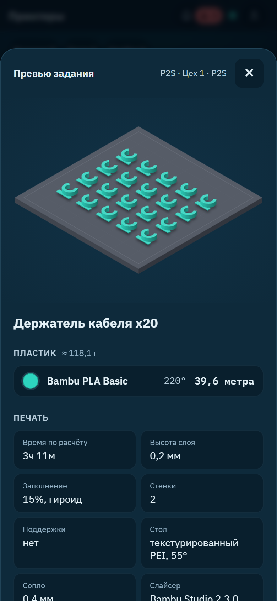

*На телефоне — «История → Пластик» и карточка задания, выезжающая снизу.*

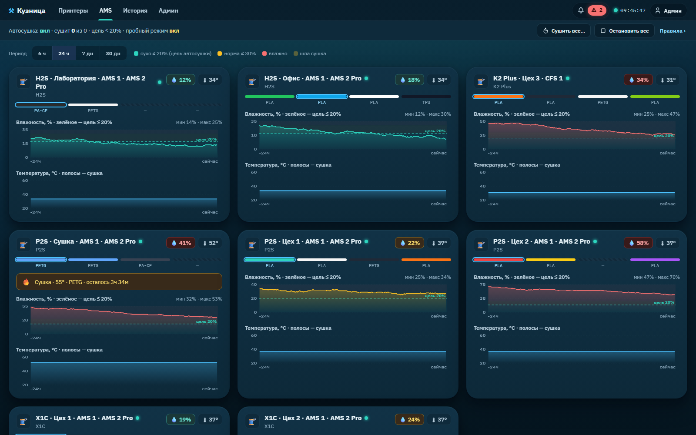

*«AMS» — влажность и температура каждого блока с периодами сушки и строка автосушки сверху.*

## С чего начать

1. [Установите](install/index.md) панель — Docker, Windows или Linux / Raspberry Pi.
2. [Первый запуск](install/first-run.md) — узнайте пароль администратора и войдите.
3. [Добавьте принтеры](printers.md).
4. По желанию настройте [Telegram](telegram.md) и [HTTPS](security.md#https-nginx).
