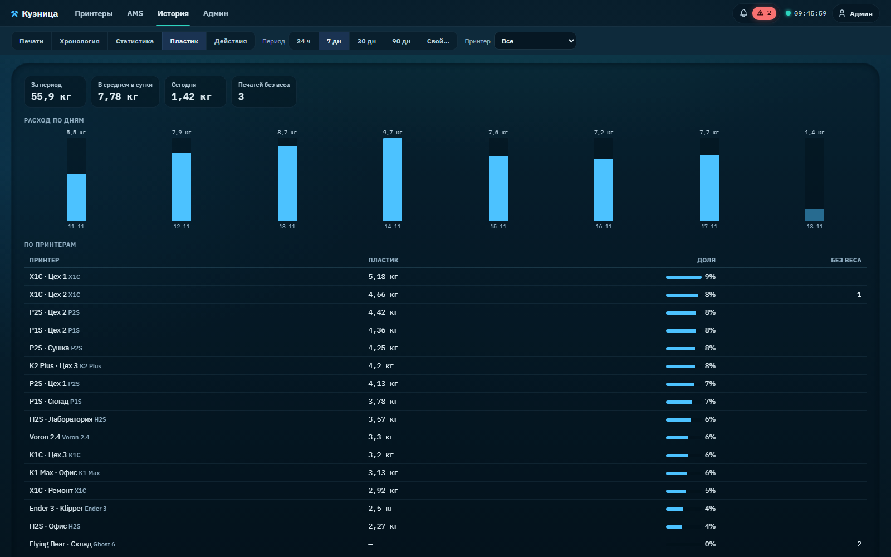

# Экран «История»

В «Истории» пять вкладок: **«Печати»**, **«Хронология»**, **«Статистика»**, **«Пластик»** и, для
администраторов, **«Действия»**.

## Фильтры для всех вкладок

Шапка общая для всех вкладок и сохраняется при переключении между ними:

- **«Период»**: **24 ч**, **7 дн**, **30 дн**, **90 дн** или **«Свой…»** (выберите даты **«С»** и
  **«по»** и нажмите **«Применить»**).
- **«Принтер»**: «Все» или один принтер.
- **«Выгрузить»** (только администраторам) — скачивает список за период с фильтрами в CSV для
  Excel. Есть на вкладках «Печати» и «Действия».

На телефоне фильтры сворачиваются в строку вида «24 ч · все принтеры»; коснитесь её, чтобы
изменить.

## «Печати» — журнал печатей {#prints}

Строка на каждую печать. Столбцы: **«Принтер»**, **«Начало»**, **«Длительность (план, Δ)»**
(фактическое время против оценки слайсера), **«Результат»**, **«Паузы»**, **«Слои»**,
**«Задание»**, **«Расход (расч.)»** (вес из слайсера на всё задание, а не фактический расход; «—»,
если неизвестен).

Если у задания есть картинка из слайсера, она стоит в столбце **«Задание»**; нажмите на неё —
откроется [карточка задания](printers.md#job-card), сохранённая вместе с печатью. В CSV-выгрузке вес
тоже есть («Расчётный расход, г»).

Чипы результатов над таблицей показывают итоги и фильтруют список: «Все», «Успешно», «Отменено»,
«Ошибка», «Питание» (пропало питание), «Нет связи», «Остановлено», «Идут».

Нажмите на строку — развернутся все паузы со временем и причиной, нажатия автопропуска ошибок и то,
чем закончилась печать. Показывается по 50 строк — **«Показать ещё 50»**. При первом запуске
версии 2.0.0 журнал был восстановлен из прежней истории состояний.

## «Хронология»

**«Хронология состояний»** — состояние каждого принтера во времени цветными отрезками. Показывает
до 7 дней: при большем периоде — последние 7 дней с пояснением. Кнопка **«?»** объясняет
управление:

- компьютер: колесо — масштаб к курсору, перетаскивание — сдвиг, двойной клик — сброс, наведение —
  подробности;
- телефон: щипок — масштаб, палец вбок — сдвиг, тап — подробности, двойной тап — сброс.

Время обслуживания нарисовано штрихованным отрезком «обслуживание».

## «Статистика»

- Итоги: **«Печатей»**, **«Успешно»**, **«Часы печати»**, **«Загрузка»**, **«Факт / план»**.
- **«По принтерам»**: доли времени по состояниям, время печати, число печатей, доля успешных,
  факт против плана и самая частая причина.
- **«Печатей в день»** — сутки режутся по полуночи в часовом поясе вашего браузера.
- **«Частые причины»** — переключатель **«Ошибки»** / **«Паузы»**.

## «Пластик» {#plastic}

Сколько пластика ферма израсходовала за период из шапки — по всем принтерам или по выбранному.
Вкладку видят обе роли.

- **Плитки:** **«За период»** — итог; **«В среднем в сутки»**; **«Сегодня»** — сколько уже, если
  период захватывает сегодня; **«Печатей без веса»** — печати, для которых у панели нет веса из
  слайсера, в итоги они не вошли (плитка есть, только если такие печати есть). Вес — в граммах, от
  1 кг — в килограммах.
- **«Расход по дням»** — столбец на каждый день. Если на экране неделя или меньше, над каждым
  столбцом — его значение, под ним — дата. Наведите на столбец (или коснитесь его) — увидите вес и
  сколько печатей того дня без веса. Сегодняшний день и дни, где вес известен не у всех печатей,
  нарисованы светлее.
- **«По принтерам»** — сначала те, кто израсходовал больше: **«Принтер»**, **«Пластик»**,
  **«Доля»** (процент от итога и полоска относительно самого «прожорливого» принтера) и **«Без
  веса»** (его печати без веса).

### Как считается {#plastic-counting}

- **Вес печати** — плановый вес из слайсера на всё задание, прочитанный из файла задания (см.
  [откуда берётся карточка задания](printers.md#where-the-job-card-comes-from)); у Ender-5 Max он
  считается по длине прутка. Принтеры Klipper и MKS веса не сообщают, их печати всегда «без веса».
- **Завершённая печать** считается целиком. **Отменённая**, сорвавшаяся или остановленная — по
  напечатанной доле (последнему прогрессу), идущая — по прогрессу на сейчас. Печать, остановленная на
  0 %, ничего не израсходовала: 0 г.
- **Через полночь:** вес печати распределяется поровну по часам, пока она шла, поэтому печать через
  полночь делится между двумя днями.
- **Сутки** режутся по полуночи в часовом поясе вашего браузера.
- **«В среднем в сутки»** считается только по дням, где вес известен хотя бы у 90 % печатей, начиная с
  первого дня с весом, и без сегодняшнего дня (он ещё идёт). День совсем без печатей считается как
  0 г.
- Печати в режиме обслуживания учитываются: пластик на них всё равно потрачен.
- **Вес записывается только для печатей с тех пор, как появилась эта функция.** У печатей, записанных
  до установки версии 2.2.0, веса нет (в пояснении под вкладкой стоит 14.11.2026 — день, когда
  функция появилась). Если за период веса нет совсем, график пишет «Вес пластика панель записывает с
  14.11.2026 — за этот период его нет».

## «Действия» (администраторам) {#actions-administrators}

Журнал, кто что сделал, — люди и автоматика. Чипы — группы с количеством: «Все», «Команды»,
«Автоматика», «Парк и настройки», «Доступ и входы». **«Кто»** — фильтр по пользователю. Служебные
записи (обновление токенов сеанса) по умолчанию скрыты — их показывает чип «Служебные · скрыты».

Столбцы: **«Время»**, **«Кто»**, **«Что»**, **«Принтер»**, **«Устройство»**. Нажмите на строку,
чтобы увидеть IP-адрес, браузер и исходную запись.

## Сколько хранится история

| Данные | Срок | Переменная |
| --- | --- | --- |
| История состояний, хронология, уведомления, история AMS | 90 дней | `HISTORY_RETENTION_DAYS` |
| Завершённые печати в журнале | 730 дней | `JOBS_RETENTION_DAYS` |

См. [Настройки и переменные окружения](../configuration.md).
