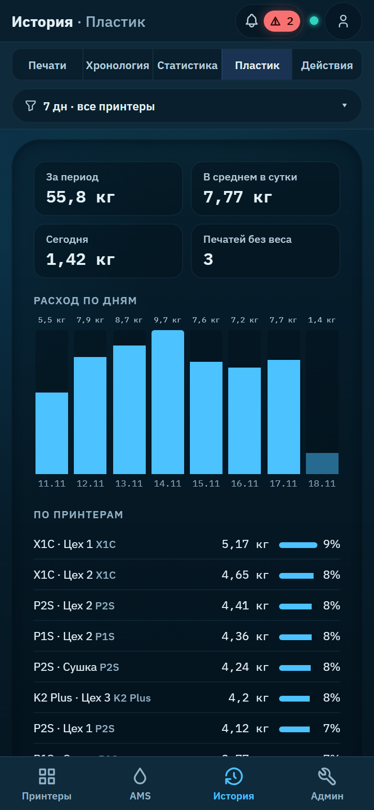
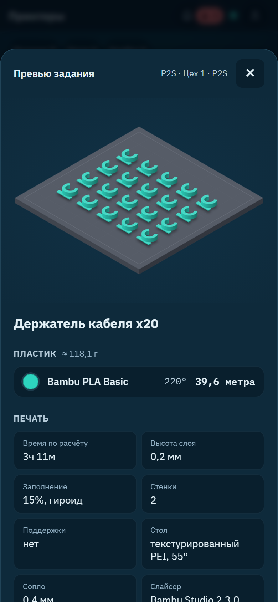

# Телефон и приложение (PWA)

## Вид на телефоне

На экране уже 900 px панель переключается на телефонный вид:

- **Нижняя навигация** с теми же экранами — «Принтеры», «AMS», «История», «Админ» (значок над
  словом). Повторное касание текущей вкладки прокручивает наверх.
- Тонкая **верхняя строка** с названием экрана (например, «История · Печати»), колокольчиком и 👤.
- Одна колонка карточек.
- Порядок и команды фермы — в листе **«Ферма ▾»**.
- Финиши открываются списком (**«Финиши»**) с группами «Готовы · снять пластину», «Ближайшие N ч»,
  «Позже» и «Без оценки».
- Каждое всплывающее окно выезжает **листом снизу**; жест «Назад» на телефоне его закрывает.
- Блоки AMS — строками в одну линию; таблицы админки (парк, пользователи, прокси) — карточками.
- На «Хронологии»: щипок — масштаб, палец вбок — сдвиг, тап — подробности, двойной тап — сброс.

### Новые экраны на телефоне

- **«История → Печати»** — три короткие строки на печать: принтер, начало и результат; название
  задания отдельной строкой; длительность, вес и паузы. Коснитесь строки — откроются подробности.
- **«История → Пластик»** — плитки по две в ряд. **«По принтерам»** превращается в блок на каждый
  принтер без заголовков столбцов, поэтому на телефоне (640 px и уже) столбец **«Без веса»** убран:
  число остаётся в плитке «Печатей без веса». На самых узких экранах подписи над столбцами дней
  мельче.
- **Карточка задания** — на экране до 600 px выезжает снизу на всю ширину, картинка ниже, настройки
  печати в два столбца. Чтобы выбрать деталь для пропуска, коснитесь её на схеме стола. Жест «Назад»
  закрывает карточку.
- **«Файлы на принтере»** — такой же лист на всю ширину; списки «пластик → слот» уже, «Назад»
  закрывает окно (‹ в его заголовке возвращает к списку файлов).
- **«Общие файлы по моделям»** («Админ → Парк») — таблица файлов прокручивается вбок; во время
  синхронизации у каждого принтера — имя, полоса и статус под полосой.

 

*«История → Пластик» и карточка задания на телефоне.*

## Установка как приложения (PWA) {#install-pwa}

Панель можно установить как приложение: тогда она открывается в своём окне со значком «Кузница»,
без адресной строки браузера.

1. Откройте панель в браузере по её **HTTPS**-адресу. Браузеры предлагают установку только на
   защищённом адресе — см. [HTTPS через nginx](../security.md#https-nginx).
2. Войдите и откройте **👤 → «Этот браузер»**. Когда браузер предложит установку, там появится
   раздел **«Приложение»** с кнопкой **«Установить»**. Можно также воспользоваться командой
   установки в меню самого браузера.

Что даёт приложение:

- **Ярлыки** на значке приложения: «Нужно решение», «Финиши» и «AMS».
- **Прогресс в заголовке**: «(N⚠) P% · Кузница» — сколько принтеров требуют внимания и прогресс
  фермы; на значке — кольцо прогресса.

Приложение — это та же веб-страница: ему нужна связь с вашим сервером панели. На устройстве
кэшируются только статические файлы (стили, скрипты, значки) — никогда данные принтеров, — и кэш
очищается при выходе из учётной записи.
