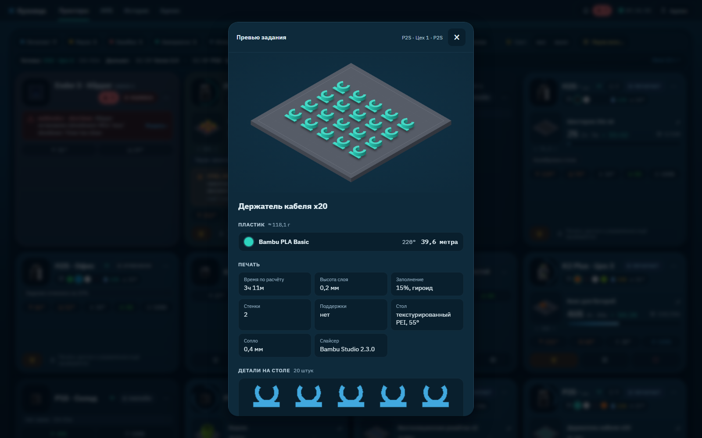
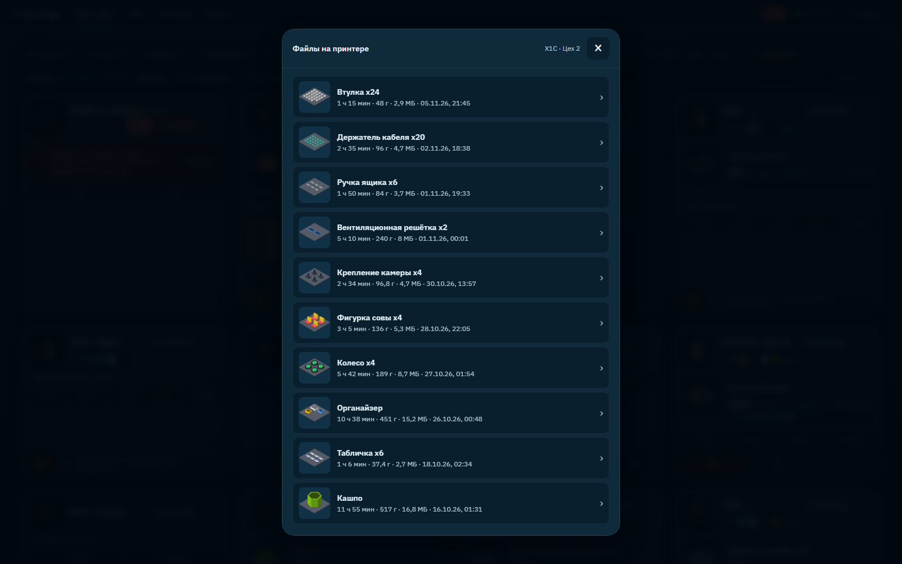

# Экран «Принтеры»

Главный экран: по карточке на каждый принтер, а над ними — строка фермы.

## Строка фермы

### Фильтры по состоянию

Чипы **«Печатает»**, **«Пауза»**, **«Ошибка»**, **«Завершено»**, **«Отменено»**, **«Простой»**,
**«Офлайн»** и **«Обслуживание»** («Обсл.» на телефоне) показывают, сколько принтеров в каждом
состоянии. Это ещё и фильтры:

- нажмите чип — останутся только эти принтеры;
- нажмите ещё раз — все принтеры;
- ++ctrl++ + клик — добавить состояние к выбору.

Выбор запоминается в этом браузере.

### Порядок

**«Порядок»**: **«Имя»** (по имени, P2 раньше P10) или **«Финиш»** (сначала завершившие печать,
затем печатающие — по времени до конца, остальные по имени). Принтер, который ждёт решения, всегда
первый.

### Команды фермы (администраторам)

- **«Свет: вкл / выкл»** — на всех онлайн-принтерах с управляемым светом.
- **«Пауза всех…»** — открывает окно, где вы отмечаете, какие печатающие принтеры поставить на
  паузу, затем **«Пауза выбранных (N)»**.
- **«Продолжить N»** — появляется, только если что-то стоит на паузе; вы выбираете, что продолжить,
  затем **«Продолжить выбранные (N)»**.

Если часть принтеров не подтвердила команду, появится строка об этом с кнопкой **«Повторить»**.
Принтеры на обслуживании пропускаются. На телефоне эти элементы — в листе **«Ферма ▾»**.

### Финиши

Под строкой фермы: **«Готовы:»** — завершившие печать принтеры, у которых пора снимать пластину
(или «нет — снимать нечего»), и **«Дальше:»** — время ближайших финишей. Кнопка **«Окно 12 ч ▾»**
разворачивает шкалу ближайших финишей с **«Горизонтом»** **12 ч** или **24 ч**.

Принтеры на обслуживании и принтеры офлайн сутки и дольше сворачиваются в группу
**«Не в работе · N»**.

## Карточка принтера

На карточке — имя и модель с картинкой модели (официальной для каждой модели Bambu и Creality; если
стоит AMS или CFS — фото комплекта), состояние, прогресс, сколько осталось, текущее задание, чипы
температур (сопло, стол, камера), слоты и влажность AMS или CFS, скорость и вентиляторы, если
принтер их сообщает, и сигнал Wi-Fi значком (dBm в подсказке).

### Картинка и вес задания {#job-picture}

Пока принтер Bambu или Creality печатает, слева от прогресса стоит картинка стола из слайсера, а под
ней — вес задания, например «≈ 128 г». Справа от картинки — название детали, строка показателей и
полоса прогресса. Нажмите на картинку или название — откроется [карточка задания](#job-card).

Вес — оценка слайсера на **всё задание** (подсказка «Расчётный расход на всё задание»), а не то, что
уже израсходовано. Он берётся из файла самого задания — см. [откуда берётся карточка
задания](#where-the-job-card-comes-from). Ender-5 Max сообщает только длину прутка, поэтому его вес
считается по длине (см. [Добавление принтеров → Ender-5 Max](../printers.md#ender-5-max)).

Задание без картинки показывается по-старому: название под прогрессом, рядом вес, если он известен.
У принтеров Klipper и MKS нет ни картинки, ни веса.

### Графики температур

Нажмите на чип температуры — откроется график сопла, стола или камеры за **6ч / 24ч / 7д**: текущая
температура, цель пунктиром и мин / ср / макс. У администратора в том же окне сверху — установка
температуры: кнопки-пресеты (сопло: PLA 220, PETG 250, ABS 260, «Выкл»; стол: 60 / 80 / 100 /
«Выкл»; камера: 40 / 50 / 60 / 65 / «Выкл» — только у принтеров с активно нагреваемой камерой:
серия Bambu H2 и Creality K2 Plus / K2 Pro, если принтер сообщает цель камеры) и **OK**.

Ещё у администратора:

- Чип **скорости** — **«Скорость печати»**: «Тихий · 50 %», «Стандарт · 100 %», «Спорт · 124 %»,
  «Безумный · 166 %». На Creality — только во время печати.
- **Вентиляторы** — **«Вентиляторы, %»**: ползунки «Деталь», «Вспом.», «Камера» и **«Применить»**.
  У Ender-5 Max нет вспомогательного вентилятора, а обдув детали и корпуса только включается или
  выключается, поэтому вместо ползунков у него списки «Вкл» / «Выкл».
- **«Воздуховод»** (P2S и серия H2) — под вентиляторами, см. [Режим воздуховода](#air-duct).
- Чип **AMS** на Bambu — выберите слот и **«Загрузить»**, **«Выгрузить»**, **«Сушить…»** или
  **«Остановить сушку»**. Загрузка и выгрузка работают только на простаивающем принтере и просят
  подтверждения с объяснением, что сделает принтер. У каждого блока есть ещё **«Катушки: метка,
  материал…»** (см. [Катушки](#spools)) и, если принтер их сообщает, **«⚙ Настройки AMS»**. Принтер
  без AMS показывает «внешняя катушка» с кнопкой **«Выгрузить филамент»**.
- Чип **CFS** на Creality — см. [CFS у Creality](#creality-cfs).

Зритель видит те же чипы, но только с графиками (чипы AMS и CFS показывают слоты без кнопок).

### Режим воздуховода (P2S, серия H2) {#air-duct}

У принтеров, которые сообщают переключаемый воздуховод, внизу окна вентиляторов есть строка
**«Воздуховод»**:

- **«Охлаждение»** — «Воздух камеры выводится наружу»;
- **«Обогрев»** — «Воздух остаётся в камере и идёт через фильтр».

Режим отправляется сразу, без **«Применить»**; текущий подсвечен. У других принтеров строки нет, а
сервер отклоняет для них эту команду.

### Катушки {#spools}

**«Катушки: метка, материал…»** в окне AMS открывает список слотов блока. У каждого слота:

- **«Метка»** — AMS прокрутит катушку и заново прочтёт RFID-метку. Только когда принтер стоит: не во
  время печати или паузы и не во время смены филамента.
- **«Изменить…»** — задать катушку слота вручную: чип материала (PLA, PLA-CF, PETG, PETG-CF, PCTG,
  ABS, ASA, TPU, PA, PA-CF, PC, PVA, HIPS), цвет и диапазон сопла («Сопло от» / «Сопло до»,
  150–350 °C; обычный диапазон материала подставляется сам), затем **«Записать»**. Принтер получает
  профиль Bambu «Generic» этого материала; следующее чтение метки его перезапишет. Можно в любое
  время, кроме слота, который сейчас подаёт пруток в печать.

**«⚙ Настройки AMS»** показывает переключатели, которые сообщает принтер: **«Запасная катушка»**
(продолжить печать с другой катушки того же материала и цвета, когда текущая закончится) и
**«Оценка остатка»** (приблизительная оценка для катушек с меткой Bambu). Администратор их
переключает, остальным они видны только для чтения.

### CFS у Creality {#creality-cfs}

У Creality с CFS на карточке есть чип CFS, устроенный как чип AMS; на экране «AMS» у каждого блока
CFS — графики влажности и температуры, как у блока AMS (сушки для него нет). Администратор
открывает его окно:

- у каждого блока CFS — влажность и температура, слоты с материалом и остатком в процентах; внешняя
  катушка показывается, когда работает она;
- кнопка слота загружает его, у загруженного — выгружает;
- **«Катушки: метка, материал…»** — **«Метка»** перечитывает метку слота; поле материала и цвет,
  затем **«Записать»**, задают слот вручную;
- **«⚙ Настройки CFS»** — **«Запасная катушка»**, если принтер её сообщает.

Загрузка, выгрузка и чтение метки сначала спрашивают на самой кнопке («Загрузить слот 2?» — нажмите
ещё раз). Команды слотов работают, только когда принтер простаивает, завершил или отменил печать;
иначе окно пишет «Только в простое — принтер печатает или занят».

### Строка управления (администраторам)

У онлайн-принтеров под карточкой — строка кнопок. Кнопка появляется, только если этот принтер так
умеет (по маркам — см. [Добавление принтеров](../printers.md)), а сама строка следует за состоянием
принтера, чтобы в ней не было кнопок, которые в этом состоянии всегда серые:

- **печатает** — свет, пауза, стоп;
- **на паузе** — свет, продолжить, стоп, остудить;
- **стоит** (простой, завершено, отменено, ошибка) — свет, остудить, опустить стол, перемещение.

| Кнопка (подсказка) | Что делает | Спрашивает? |
| --- | --- | --- |
| 💡 Свет («Свет горит — выключить» / «Свет выключен — включить») | Включает / выключает свет | нет |
| ⏸ «Пауза» / ▶ «Продолжить печать» | Ставит печать на паузу или продолжает | нет |
| ⏹ «Остановить печать» | Останавливает печать | да — «Остановить печать?» → **«Стоп»** |
| ❄ Остудить («Остудить всё: сопло и стол», плюс камера, где её можно задать) | Ставит нагреватели на 0 | только на паузе — «На паузе — остудить?» |
| ⤓ «Опустить стол на 3 см, чтобы снять деталь» | Опускает стол на 3 см | нет |
| ✥ «Перемещение, «Домой», филамент» | Открывает [окно перемещения](#motion): «Домой», сдвиг осей, подача / втягивание прутка | нет |

Кнопка, которой сейчас нельзя воспользоваться, серая, а подсказка объясняет почему — например,
«Во время печати остудить нельзя — сначала пауза или стоп». Сервер отклоняет команды, которые
запрещает текущее состояние принтера.

**🔒 Замок** означает, что свет работает, а управление печатью — нет; в подсказке причина (у Bambu
обычно «прошивка блокирует (нет Developer Mode)» — см. [Добавление принтеров](../printers.md#bambu-lab)).
У принтеров MKS строки управления нет.

### Перемещение, «Домой» и филамент {#motion}

Кнопка ✥ у стоящего принтера (Bambu, Creality, Klipper) открывает окно **«Перемещение»**:

- **«Шаг»** — 1, 10 или 50 мм (по умолчанию 10 мм);
- **«Домой»** — найти нули всех осей;
- **X− / X+** (голова влево / вправо), **Y+ / Y−** (голова назад / вперёд), **Z+ / Z−** (стол дальше
  от сопла / ближе к соплу) — один шаг на нажатие;
- **«Филамент · сопло 215°»** (с текущей температурой сопла) — **«E− втянуть»** вытягивает пруток из
  сопла на шаг, **«E+ подать»** подаёт его.

Окно остаётся открытым между нажатиями, ответ на каждое — в его строке. Правила:

- Оси и пруток двигаются, только когда принтер стоит — не во время печати или паузы и не во время
  смены филамента («Оси двигаются, только когда принтер стоит — не во время печати и не на паузе»).
- После включения сначала нажмите **«Домой»**. Klipper сам не двигает ось, у которой не найден ноль.
- Подача и втягивание — только с горячим соплом, от 170 °C («Сопло холодное — подача и втягивание
  только от 170 °C, сначала нагрев»): сначала нагрейте сопло через его чип температуры.
- Creality не принимает подачу и втягивание из панели: кнопки E у него серые с подсказкой
  «Creality: подача и втягивание только с экрана принтера».

### Меню ⋯

В **⋯** в заголовке карточки у всех есть ссылки на печати этого принтера («Печати принтера ›») и
его хронологию («Хронология принтера ›»). У администратора ещё:

- режим обслуживания (см. [ниже](#maintenance-mode));
- **«Файлы на принтере ›»** (Bambu и Creality, пока принтер на связи) — см.
  [Файлы на принтере](#files-on-the-printer);
- **«Сервис ›»** (только Creality с Klipper API, например K2 Plus) — см. [«Сервис»](#k2-service);
- **«Параметры принтера ›»** — открывает форму принтера в «Админ → Парк».

## Режим обслуживания {#maintenance-mode}

Нужен, когда принтер в ремонте или на обслуживании. Администратор включает его в меню **⋯**
карточки:

- **«На обслуживании…»** — необязательная заметка («что делаем», до 200 символов), затем
  **«Поставить»**.
- На обслуживании: **«Заметка обслуживания…»** и **«✓ Снять с обслуживания»** (с подтверждением).

Карточка продолжает показывать настоящее состояние и строку вида «обслуживание · с 14:32 ·
<заметка>». Принтер исключается из подсчёта состояний, загрузки, финишей, уведомлений (значок,
колокольчик, всплывающие уведомления браузера, Telegram), команд фермы, автосушки AMS и
автопропуска ошибок; на хронологии его время показано штрихованным отрезком «обслуживание».
Команды с его собственной карточки работают.

## Уведомления принтеров {#printer-notifications}

Каждое сообщение HMS и ошибка печати Bambu перечислены на карточке принтера; Creality показывает
код своей ошибки, Klipper — причину остановки.

- **Значок** «⚠ N» цветом самого серьёзного уровня появляется, когда нужно решение или критичной
  ошибке меньше 30 минут; иначе — серый «ⓘ N». Нажмите, чтобы увидеть список.
- **Полоса** под прогрессом — для критичной ошибки или паузы-ошибки, пока принтер на паузе или в
  ошибке. В конце — **«Решить ›»** для администратора или **«Подробнее ›»**.
- **Уровни:** «Критично», «Пауза-ошибка», «Серьёзно», «Уведомление», «Инфо». Напоминания об
  обслуживании свёрнуты как «плановые».
- **Кнопки действий** — те же, что Bambu Studio показывает для этого кода (из таблиц самой Bambu),
  например «Продолжить печать», «Игнорировать и продолжить», «Остановить печать». Их видят только
  администраторы. Каждое действие сверяется с живым принтером прямо перед отправкой; опасные
  спрашивают подтверждение (например, «Остановить печать? Задание будет потеряно.»).
- **«Скрыть»** (администратор) — уведомление перестаёт учитываться в значке, колокольчике,
  заголовке вкладки и всплывающих уведомлениях браузера — у всех. Скрытые лежат в «скрытые · N» с
  кнопкой **«Вернуть»**. Принтеру ничего не отправляется.

**Ошибки Creality.** В уведомлении об ошибке Creality — тот же ответ, что даёт собственная
веб-страница принтера:

- **«Сбросить ошибку»** — убирает ошибку с принтера. Печать она не продолжает и не останавливает;
  сначала устраните причину.
- **«Перезапустить прошивку»** — для кодов ошибок, на которые страница принтера отвечает
  перезапуском (1–6, 8 и 200). Спрашивает подтверждение («Перезапустить прошивку принтера? Он
  перезагрузится, текущее задание будет потеряно.») и не выполняется, пока принтер печатает или
  стоит на паузе.
- **«Продолжить печать»** — у K2 Plus на паузе (через Klipper API), то же, что ▶ на карточке:
  принтер нагреет сопло до прежней температуры, выдавит около 80 мм прутка у места очистки, почистит
  сопло и продолжит. Сначала посмотрите на деталь. Пауза от ИИ-контроля камеры названа (код AC0101).

**Колокольчик** в верхней строке показывает сначала принтеры, которым «Нужно решение», остальные —
свёрнутыми. Внизу у администратора — **«Сбросить ошибки (N)»**: закрывает на экранах принтеров
диалоги «Задача отменена» и сначала показывает, какие принтеры «Попадут», а какие «Не попадут».
Принтеры Creality туда не входят — у каждого своя кнопка в уведомлении.

## Карточка задания {#job-card}

Нажмите на картинку или название задания — на карточке принтера или в
[«История → Печати»](history.md#prints) — откроется **карточка задания** («Превью задания»). В ней
то, что подготовил слайсер:

- принтер и его модель, у задания Bambu — номер пластины;
- картинка стола из слайсера и название задания;
- в истории — **«Плановое время»** слайсера (у идущего задания время до конца — на его карточке);
- **«Пластик»** с общим весом, затем каждый пластик: цвет, тип и профиль слайсера, температура
  сопла, граммы (если пластиков несколько) и метры;
- **«Печать»** — время по расчёту, высота слоя (и первого слоя), заполнение и его узор, стенки,
  поддержки и их вес, тип и температура стола, диаметр сопла, размер детали, паузы по плану, порядок
  «по объектам», разглаживание, таймлапс и слайсер с версией — каждое, только если оно есть в файле;
- **«Детали на столе»** — сколько деталей, схема стола и названия деталей с ×N для копий и
  пропущенными.

Чего в файле нет, то не показывается — ничего не додумывается.

### Откуда берётся карточка задания {#where-the-job-card-comes-from}

| Принтер | Что читает панель | Что попадает в карточку |
| --- | --- | --- |
| Bambu X1, P2, H2, X2 | данные текущего задания из памяти принтера; 3MF задания с SD-карты или флешки, если он там есть | из памяти: картинка, пластики, вес, время, детали и схема стола. Настройки печати (высота слоя, заполнение, стенки, поддержки…) — только если файл задания лежит и на SD-карте или флешке |
| Bambu P1, A1 | 3MF задания с SD-карты | всё, что есть в файле |
| Creality K1C и другие | список файлов принтера и картинка текущей печати | картинка, пластики (тип, цвет, граммы), время, температуры сопла и стола, размер детали, слайсер |
| Creality K2 Plus | то же и G-код задания через Klipper API | ещё высота слоя, заполнение, стенки, поддержки и их вес, стол, профили пластиков и версия слайсера |
| Creality Ender-5 Max | его старый список файлов, где есть длина прутка, и картинка текущей печати | картинка и вес, посчитанный по длине |
| Klipper, MKS | — | карточки задания нет |

Вес поддержек считается по G-коду задания (слайсер пишет только общий вес), поэтому он может
появиться на несколько минут позже остального. Карточка хранится вместе с печатью: она открывается
из [«История → Печати»](history.md#prints) и после того, как принтер взялся за другое, а ночное
резервное копирование сохраняет её (`data/job_previews/`).

## Пропуск деталей на ходу {#skip-parts}

На печатающем или стоящем на паузе принтере Bambu или Creality администратор может пропустить
отдельные детали стола — например, оторвавшуюся — и допечатать остальные.

1. Откройте карточку задания с карточки принтера (не из истории: там схема — просто картинка).
2. Нажмите на схеме стола детали, которые нужно пропустить, — они станут красными; при наведении
   видно название. Строка под схемой их считает: «Выбрано: 2».
3. Нажмите **«Пропустить N детали»**, затем ещё раз, когда кнопка спросит «Точно пропустить?
   Нажмите ещё раз».

Уже пропущенные детали серые и посчитаны («Пропущено: N»). Пропустить все детали нельзя — для этого
есть **«Стоп»** («Пропустить все детали нельзя — для этого есть «Стоп»»). Перед отправкой сервер ещё
раз сверяет детали с идущим заданием.

- **Bambu:** схема — картинка стола из слайсера со всеми деталями. Задание должно быть нарезано с
  включённой маркировкой деталей; иначе карточка пишет «Маркировка деталей не включена в слайсере —
  пропуск недоступен».
- **Creality** (K2 Plus, K1C, Ender-5 Max): принтер сам сообщает детали с контурами в миллиметрах
  стола, они рисуются на столе; подсказка отмечает и деталь, которая печатается сейчас («печатается
  сейчас»). Детали без контуров — списком с галочками. В задании должно быть не меньше двух деталей.

Зритель видит схему без кнопки.

## Файлы на принтере {#files-on-the-printer}

**⋯ → «Файлы на принтере ›»** (администратор, Bambu и Creality) показывает файлы печати, которые
лежат на принтере, новые сверху: картинка, название, время по расчёту, граммы, размер и дата. Список
читается с принтера при каждом открытии («Получаю список файлов с принтера…»); картинки Bambu
подгружаются по одной.

Нажмите на файл — откроется **«Печать файла»**:

- **Bambu:** кнопка на каждый стол, если их в файле несколько; время, граммы и диаметр сопла стола;
  **«Пластик → слот»** — слот для каждого пластика стола, подобранный заранее (загруженный слот того
  же материала с ближайшим цветом, иначе внешняя катушка), его можно сменить; **«Калибровка стола»**
  (включена) и **«Таймлапс»** (выключен).
- **Creality:** время, граммы, размер и дата файла и его пластики. K2 подберёт слоты CFS сам, как
  при запуске с экрана.

**«Печать»** сначала спрашивает на самой кнопке — «Стол чистый? Нажмите ещё раз — печать начнётся»
— второе нажатие запускает. Ответ: «Принтер принял задание» или «Задание отправлено, ждём принтер».
Каждый запуск записывается в [«История → Действия»](history.md#actions-administrators).

Запуск не выполняется, если:

- принтер не свободен — печатает, на паузе, готовится или меняет филамент (запускайте, когда он
  простаивает, завершил или отменил печать);
- файла нет в списке, прочитанном за последние 5 минут («Этого файла нет в свежем списке — откройте
  список файлов заново»);
- принтер Bambu не принимает команды печати (нет Developer Mode, см.
  [Добавление принтеров](../printers.md#bambu-lab));
- у принтера два сопла (H2D, H2C, X2D) — пока не поддерживается;
- принтер не отдаёт содержимое файла, и его столы не прочитать — тогда запускайте с экрана принтера
  («Принтер не отдаёт содержимое этого файла…»).

Что показывает каждый принтер:

| Принтер | Какие файлы видны | Запуск из панели |
| --- | --- | --- |
| Bambu X1 | память принтера (SD-карта) | да |
| Bambu P1, A1 | SD-карта | да |
| Bambu P2S и другие H2 / X2 | внутренняя память и флешка | файлы с флешки; из внутренней памяти — только с экрана принтера |
| Bambu H2S | только флешка: внутреннюю память принтер по сети не открывает, и без флешки окно так и пишет («Принтер не открывает свою память по сети…») | файлы с флешки |
| Creality | список файлов принтера | да |
| Creality K2 Plus | через Klipper API, с картинками, временем и граммами из списка файлов | да; ещё **«Удалить с принтера»** (спрашивает на кнопке, только когда принтер свободен) |

Если флешку P2S или H2 прочитать не удалось, файлы внутренней памяти всё равно показываются, с
пометкой над списком. Заводские образцы (3DBenchy, Vase и т. п.) по умолчанию скрыты; если
выключить [«Скрывать заводские образцы»](admin.md#general), они идут в конце списка с пометкой
«образец».

Чтобы на всех принтерах одной модели были одни и те же файлы, используйте
[Общие файлы по моделям](shared-files.md).

## «Сервис» (K2 Plus) {#k2-service}

**⋯ → «Сервис ›»** (администратор) есть у Creality, который отвечает через Klipper API (Moonraker,
порт 7125), например у K2 Plus. Каждая кнопка запускает собственный макрос принтера:

| Кнопка | Что делает принтер |
| --- | --- |
| **«Калибровка стола»** | автовыравнивание: нагрев стола и сопла, очистка сопла о стол, карта стола — 10–20 мин |
| **«PID сопла»** | нагрев сопла с обдувом; в конце Klipper сохранит настройку и перезапустится |
| **«PID стола»** | нагрев стола; в конце Klipper сохранит настройку и перезапустится |
| **«Калибровка резонансов»** | голова в центр, замер вибраций по X и Y, сохранение |
| **«Натяжение ремней»** | моторы отключатся, модули натяжения подтянут оба ремня |
| **«Перезапуск прошивки»** | Klipper и платы принтера перезапустятся, около минуты |

Каждая кнопка сначала спрашивает на себе («Запустить «…»? Нажмите ещё раз»). «Сервис» работает,
только когда принтер свободен — не печатает, не на паузе, без ошибки, — и по одной команде за раз;
пока она идёт, видны последние строки консоли принтера. Ручной калибровки стола, калибровки оси Z,
печати калибровки и ножа здесь нет: они запускаются с экрана принтера.

## Свет при остановке принтера {#lamp-on-stop}

Когда принтер переходит в **паузу**, **ошибку** или **отмену**, панель включает свет в его камере —
чтобы по камерам было видно, что случилось. Один раз на остановку и только если свет выключен: если
выключить его снова, он не включится до следующей остановки. Пауза, которую сейчас пропустит
[автопропуск ошибок](admin.md#auto-skip-errors), свет не включает — если только автопропуск от неё не
отступится. Каждое включение пишется в «История → Действия», группа «Автоматика». Принтеры без
управляемого света не трогаются. Какие состояния включают свет, можно поменять без страницы — см.
[Настройки](../configuration.md#settings-without-a-page).

## Заголовок вкладки

Вкладка браузера показывает ферму одним взглядом: «(N⚠) P% · Кузница», а если сервер не отвечает
30 секунд — «нет связи · Кузница». На значке вкладки — кольцо прогресса.
