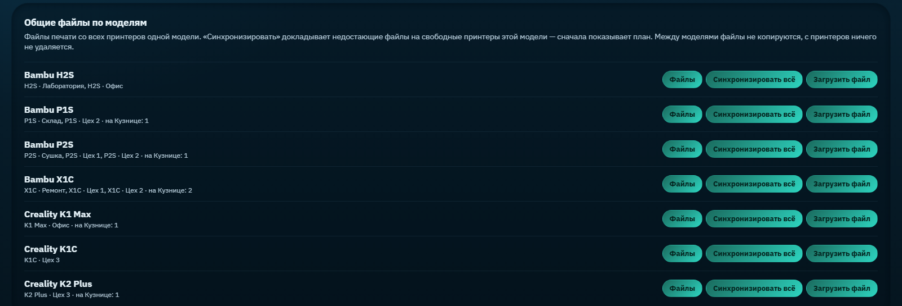

# Общие файлы по моделям

Одни и те же файлы печати на всех принтерах одной модели: загрузите файл в панель один раз (или
возьмите его с одного принтера) и разошлите остальным принтерам этой модели одной кнопкой.

Раздел находится в **«Админ → Парк»**, под таблицей принтеров, поэтому его видят только
администраторы.

## Группы

Каждая модель Bambu и Creality из парка — отдельная группа с названием как на карточке принтера,
например «Bambu P1S» или «Creality K2 Plus», со списком её принтеров и числом файлов, загруженных в
панель («на Кузнице: N»). Модели не смешиваются: файл уходит только на принтеры той же модели. У
принтеров Klipper и MKS групп нет.

Кнопки группы:

- **«Файлы»** — разворачивает файлы группы. Панель спрашивает список у каждого принтера модели
  («Собираю списки файлов с принтеров…») и добавляет свои загрузки. Одинаковые имя и размер — один и
  тот же файл.
- **«Синхронизировать всё»** — или, если в списке отмечены файлы, **«Синхронизировать выбранные:
  N»**. Сначала показывает план.
- **«Загрузить файл»** — загружает файл с вашего компьютера в панель: нарезанный `.gcode.3mf` для
  Bambu, `.gcode` для Creality.

## Список файлов

| Столбец | Что в нём |
| --- | --- |
| галочка | выбрать файл для **«Синхронизировать выбранные»**; она есть только у файлов, которые можно скопировать |
| **«Файл»** | название; «на Кузнице» — файл загружен в панель, «образец» — заводской образец, «не копируется» с причиной — файл никто не отдаёт |
| **«Размер»** | |
| **«Где лежит»** | по чипу на каждый принтер модели; подсвечены те, где файл есть |
| × | **«Убрать из хранилища Кузницы»** — у загруженного файла; убирает его только из панели, с принтеров — никогда |

Принтеры, которые не прислали список, перечислены над ним («Без списка: …» с причиной, например
«не на связи»).

## Синхронизация

1. Нажмите **«Синхронизировать всё»** (или **«Синхронизировать выбранные»**). Панель считает план
   («Считаю план…»).
2. План пишет **«План: N копий, …»** и для каждого принтера — сколько файлов и байт он получит
   (**«какие»** разворачивает названия). Ещё в нём:
    - файлы, которые **не тронем**, потому что на принтере уже лежит другой файл с тем же именем
      («Не тронем (там другой файл с тем же именем)»);
    - **пропущенные** принтеры и почему («Пропущены:» — не на связи, занят печатью или подготовкой,
      нет флешки, нет SD-карты…);
    - файлы, которые **не скопировать**, потому что их не отдаёт ни один принтер («Не скопировать»).
3. Нажмите **«Копировать»**, затем ещё раз, когда кнопка спросит «Нажмите ещё раз — начнём
   копировать». **«Отмена»** сбрасывает план.
4. Копирование идёт с полосой на каждый принтер: «ждёт», «копирую», «готово», «ошибка» или
   «пропущен», со счётчиком файлов и текущим файлом. Синхронизация идёт одна за раз и продолжается,
   даже если уйти со страницы.

Правила:

- **С принтеров ничего не удаляется и не перезаписывается.** Файлы только добавляются; другой файл с
  тем же именем остаётся на месте и попадает в список.
- **Между моделями — никогда.**
- Перед каждым файлом принтер проверяется заново: на связи, не печатает и не готовится.
- Свободное место принтеры не сообщают — следите, чтобы оно было.
- Заводские образцы не копируются никогда.

## Что позволяет каждый принтер

| Принтер | Отдаёт свои файлы (источник) | Принимает файлы (получатель) |
| --- | --- | --- |
| Bambu X1, P1, A1 | все файлы | на SD-карту — в принтере должна быть SD-карта |
| Bambu P2S, серия H2, X2D | только файлы с флешки | только на флешку — в принтере должна быть флешка; во внутреннюю память файлы по сети не пишутся |
| Creality K2 Plus | все файлы (через Klipper API) | да |
| Другие Creality (K1C, Ender-5 Max…) | никакие — загрузите файл в панель | да, через собственную веб-страницу принтера |

Файл, который лежит только во внутренней памяти P2S или H2, показывается как некопируемый («лежит
только во внутренней памяти — прошивка её не отдаёт; нужна копия на флешке или в панели»): положите
копию на флешку или загрузите его в панель.

## Ограничения хранилища

Загруженные файлы лежат в `data/file_pool/` на компьютере панели. Из коробки один файл — до 512 МБ,
все загрузки вместе — до 8 ГБ, и загрузка останавливается, когда на диске остаётся меньше 1 ГБ.
Файл с тем же именем, что уже загружен, не принимается. Лимиты задают `FORGE_FILE_POOL_MAX_GB`,
`FORGE_FILE_POOL_FILE_MAX_MB` и `FORGE_FILE_POOL_KEEP_FREE_MB` — см.
[Настройки](../configuration.md#file-pool).

Загрузки, синхронизации и удаления из хранилища пишутся в
[«История → Действия»](history.md#actions-administrators).

## Заводские образцы

Демо-модели из прошивки принтеров (3DBenchy, Vase и т. п.) скрыты из списка и не синхронизируются,
пока включено **«Скрывать заводские образцы»** — а оно включено по умолчанию, см.
[«Админ → Система»](admin.md#general). Если его выключить, образцы видны с пометкой «образец», но
всё равно не копируются.
